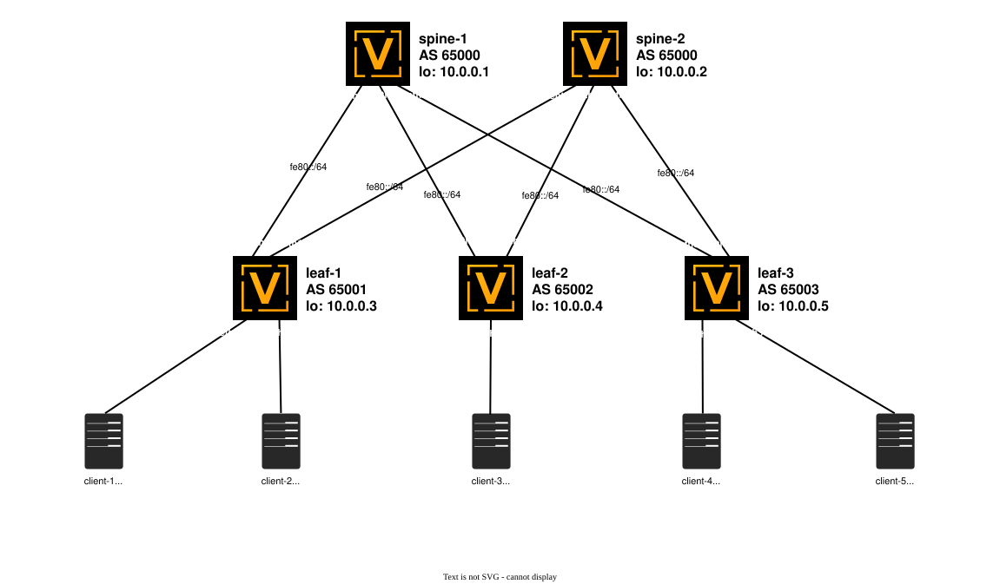

# Проектная работа на тему «Реализация EVPN-VXLAN фабрики на платформе VyOS»


<br>

## Задача
- Создать EVPN-VXLAN фабрику на платфомре VyOS (L2VPN)


<br>

## Используемые технологии

- EVPN, VXLAN, eBGP, IPv6


<br>

## Cхема сети





<br>


## Адресное пространство (IPAM)
---


### Общие подсети

- **Loopback0:** `10.0.0.0/24` (для Router ID и Loopback-интерфейсов)
    
- **P2P Links (Underlay):** `fe80::/64` (Point-to-Point линки между Spine и Leaf)
    
- **Infra / Services:** `10.0.100.0/24`, `10.0.200.0/24` (Инфраструктура и сервисы)


<br>


### Loopbacks

| **Устройство** | **IP-адрес / маска** |
| -------------- | -------------------- |
| **spine-1**    | `10.0.0.1/32`        |
| **spine-2**    | `10.0.0.2/32`        |
| **leaf-1**     | `10.0.0.3/32`        |
| **leaf-2**     | `10.0.0.4/32`        |
| **leaf-3**     | `10.0.0.5/32`        |

<br>

### PtP-подключения

| **Подсеть** | **Spine устройство & интерфейс** | **IP Spine**            | **Leaf устройство & интерфейс** | **IP Leaf**             |
| ----------- | -------------------------------- | ----------------------- | ------------------------------- | ----------------------- |
| `fe80::/64` | **spine-1** eth0                 | `fe80::eb2:c8ff:fe09:0` | **leaf-1** eth0                 | `fe80::e99:55ff:fe40:0` |
| `fe80::/64` | **spine-1** eth1                 | `fe80::eb2:c8ff:fe09:1` | **leaf-2** eth0                 | `fe80::ec8:34ff:fe5c:0` |
| `fe80::/64` | **spine-1** eth2                 | `fe80::eb2:c8ff:fe09:2` | **leaf-3** eth0                 | `fe80::efd:21ff:fec2:0` |
| `fe80::/64` | **spine-2** eth0                 | `fe80::e42:b9ff:fe7c:0` | **leaf-1** eth1                 | `fe80::e99:55ff:fe40:1` |
| `fe80::/64` | **spine-2** eth1                 | `fe80::e42:b9ff:fe7c:1` | **leaf-2** eth1                 | `fe80::ec8:34ff:fe5c:1` |
| `fe80::/64` | **spine-2** eth2                 | `fe80::e42:b9ff:fe7c:2` | **leaf-3** eth1                 | `fe80::efd:21ff:fec2:1` |

<br>

### Клиенты

| **Подсеть**     | **Spine устройство & интерфейс** | **IP Client** | **Leaf устройство & интерфейс** |
| --------------- | -------------------------------- | ------------- | ------------------------------- |
| `10.0.100.0/24` | **client-1** Ethernet0           | `10.0.100.1`  | **leaf1** eth2                  |
| `10.0.200.0/24` | **client-2** Ethernet0           | `10.0.200.1`  | **leaf1** eth3                  |
| `10.0.100.0/24` | **client-3** Ethernet0           | `10.0.100.2`  | **leaf2** eth2                  |
| `10.0.100.0/24` | **client-4** Ethernet0           | `10.0.100.3`  | **leaf3** eth2                  |
| `10.0.200.0/24` | **client-5** Ethernet0           | `10.0.200.2`  | **leaf3** eth3                  |

<br>

## Конфигурации устройств (VyOS)
---

#### spine-1

```
set interfaces ethernet eth0 description 'to leaf-1'
set interfaces ethernet eth0 hw-id '0c:b2:c8:09:00:00'
set interfaces ethernet eth0 ipv6
set interfaces ethernet eth0 mtu '9100'
set interfaces ethernet eth0 offload gro
set interfaces ethernet eth0 offload gso
set interfaces ethernet eth0 offload sg
set interfaces ethernet eth0 offload tso
set interfaces ethernet eth1 description 'to leaf-2'
set interfaces ethernet eth1 hw-id '0c:b2:c8:09:00:01'
set interfaces ethernet eth1 ipv6
set interfaces ethernet eth1 mtu '9100'
set interfaces ethernet eth1 offload gro
set interfaces ethernet eth1 offload gso
set interfaces ethernet eth1 offload sg
set interfaces ethernet eth1 offload tso
set interfaces ethernet eth2 description 'to leaf-3'
set interfaces ethernet eth2 hw-id '0c:b2:c8:09:00:02'
set interfaces ethernet eth2 ipv6
set interfaces ethernet eth2 mtu '9100'
set interfaces ethernet eth2 offload gro
set interfaces ethernet eth2 offload gso
set interfaces ethernet eth2 offload sg
set interfaces ethernet eth2 offload tso
set interfaces ethernet eth3 hw-id '0c:b2:c8:09:00:03'
set interfaces ethernet eth3 offload gro
set interfaces ethernet eth3 offload gso
set interfaces ethernet eth3 offload sg
set interfaces ethernet eth3 offload tso
set interfaces ethernet eth4 hw-id '0c:b2:c8:09:00:04'
set interfaces ethernet eth4 offload gro
set interfaces ethernet eth4 offload gso
set interfaces ethernet eth4 offload sg
set interfaces ethernet eth4 offload tso
set interfaces ethernet eth5 hw-id '0c:b2:c8:09:00:05'
set interfaces ethernet eth5 offload gro
set interfaces ethernet eth5 offload gso
set interfaces ethernet eth5 offload sg
set interfaces ethernet eth5 offload tso
set interfaces ethernet eth6 hw-id '0c:b2:c8:09:00:06'
set interfaces ethernet eth6 offload gro
set interfaces ethernet eth6 offload gso
set interfaces ethernet eth6 offload sg
set interfaces ethernet eth6 offload tso
set interfaces ethernet eth7 hw-id '0c:b2:c8:09:00:07'
set interfaces ethernet eth7 offload gro
set interfaces ethernet eth7 offload gso
set interfaces ethernet eth7 offload sg
set interfaces ethernet eth7 offload tso
set interfaces ethernet eth8 hw-id '0c:b2:c8:09:00:08'
set interfaces ethernet eth8 offload gro
set interfaces ethernet eth8 offload gso
set interfaces ethernet eth8 offload sg
set interfaces ethernet eth8 offload tso
set interfaces ethernet eth9 hw-id '0c:b2:c8:09:00:09'
set interfaces ethernet eth9 offload gro
set interfaces ethernet eth9 offload gso
set interfaces ethernet eth9 offload sg
set interfaces ethernet eth9 offload tso
set interfaces ethernet eth10 hw-id '0c:b2:c8:09:00:0a'
set interfaces ethernet eth10 offload gro
set interfaces ethernet eth10 offload gso
set interfaces ethernet eth10 offload sg
set interfaces ethernet eth10 offload tso
set interfaces ethernet eth11 hw-id '0c:b2:c8:09:00:0b'
set interfaces ethernet eth11 offload gro
set interfaces ethernet eth11 offload gso
set interfaces ethernet eth11 offload sg
set interfaces ethernet eth11 offload tso
set interfaces ethernet eth12 hw-id '0c:b2:c8:09:00:0c'
set interfaces ethernet eth12 offload gro
set interfaces ethernet eth12 offload gso
set interfaces ethernet eth12 offload sg
set interfaces ethernet eth12 offload tso
set interfaces loopback lo address '10.0.0.1/32'
set protocols bgp address-family ipv4-unicast redistribute connected
set protocols bgp neighbor eth0 interface v6only peer-group 'leaves'
set protocols bgp neighbor eth1 interface v6only peer-group 'leaves'
set protocols bgp neighbor eth2 interface v6only peer-group 'leaves'
set protocols bgp parameters bestpath as-path multipath-relax
set protocols bgp parameters router-id '10.0.0.1'
set protocols bgp peer-group leaves address-family ipv4-unicast
set protocols bgp peer-group leaves address-family l2vpn-evpn
set protocols bgp peer-group leaves bfd
set protocols bgp peer-group leaves capability extended-nexthop
set protocols bgp peer-group leaves remote-as 'external'
set protocols bgp system-as '65000'
set protocols bgp timers holdtime '9'
set protocols bgp timers keepalive '3'
set service ntp allow-client address '127.0.0.0/8'
set service ntp allow-client address '169.254.0.0/16'
set service ntp allow-client address '10.0.0.0/8'
set service ntp allow-client address '172.16.0.0/12'
set service ntp allow-client address '192.168.0.0/16'
set service ntp allow-client address '::1/128'
set service ntp allow-client address 'fe80::/10'
set service ntp allow-client address 'fc00::/7'
set service ntp server time1.vyos.net
set service ntp server time2.vyos.net
set service ntp server time3.vyos.net
set system config-management commit-revisions '100'
set system console device ttyS0 speed '115200'
set system host-name 'spine-1'
set system login user vyos authentication encrypted-password '$6$rounds=656000$cWHiRtqG3EUM7.yu$nnV/4YLuSFG40Kdza2kBx3pSV1XLQzn34jmKIcv1YBQ0a05rWfWyE5UYD7aAbAZeTJuUj5sMO.ioFmODvfUkx.'
set system login user vyos authentication plaintext-password ''
set system syslog global facility all level 'info'
set system syslog global facility local7 level 'debug'
```


<br>

#### spine-2

```
set interfaces ethernet eth0 description 'to leaf-1'
set interfaces ethernet eth0 hw-id '0c:42:b9:7c:00:00'
set interfaces ethernet eth0 ipv6
set interfaces ethernet eth0 mtu '9100'
set interfaces ethernet eth0 offload gro
set interfaces ethernet eth0 offload gso
set interfaces ethernet eth0 offload sg
set interfaces ethernet eth0 offload tso
set interfaces ethernet eth1 description 'to leaf-2'
set interfaces ethernet eth1 hw-id '0c:42:b9:7c:00:01'
set interfaces ethernet eth1 ipv6
set interfaces ethernet eth1 mtu '9100'
set interfaces ethernet eth1 offload gro
set interfaces ethernet eth1 offload gso
set interfaces ethernet eth1 offload sg
set interfaces ethernet eth1 offload tso
set interfaces ethernet eth2 description 'to leaf-3'
set interfaces ethernet eth2 hw-id '0c:42:b9:7c:00:02'
set interfaces ethernet eth2 ipv6
set interfaces ethernet eth2 mtu '9100'
set interfaces ethernet eth2 offload gro
set interfaces ethernet eth2 offload gso
set interfaces ethernet eth2 offload sg
set interfaces ethernet eth2 offload tso
set interfaces ethernet eth3 hw-id '0c:42:b9:7c:00:03'
set interfaces ethernet eth3 offload gro
set interfaces ethernet eth3 offload gso
set interfaces ethernet eth3 offload sg
set interfaces ethernet eth3 offload tso
set interfaces ethernet eth4 hw-id '0c:42:b9:7c:00:04'
set interfaces ethernet eth4 offload gro
set interfaces ethernet eth4 offload gso
set interfaces ethernet eth4 offload sg
set interfaces ethernet eth4 offload tso
set interfaces ethernet eth5 hw-id '0c:42:b9:7c:00:05'
set interfaces ethernet eth5 offload gro
set interfaces ethernet eth5 offload gso
set interfaces ethernet eth5 offload sg
set interfaces ethernet eth5 offload tso
set interfaces ethernet eth6 hw-id '0c:42:b9:7c:00:06'
set interfaces ethernet eth6 offload gro
set interfaces ethernet eth6 offload gso
set interfaces ethernet eth6 offload sg
set interfaces ethernet eth6 offload tso
set interfaces ethernet eth7 hw-id '0c:42:b9:7c:00:07'
set interfaces ethernet eth7 offload gro
set interfaces ethernet eth7 offload gso
set interfaces ethernet eth7 offload sg
set interfaces ethernet eth7 offload tso
set interfaces ethernet eth8 hw-id '0c:42:b9:7c:00:08'
set interfaces ethernet eth8 offload gro
set interfaces ethernet eth8 offload gso
set interfaces ethernet eth8 offload sg
set interfaces ethernet eth8 offload tso
set interfaces ethernet eth9 hw-id '0c:42:b9:7c:00:09'
set interfaces ethernet eth9 offload gro
set interfaces ethernet eth9 offload gso
set interfaces ethernet eth9 offload sg
set interfaces ethernet eth9 offload tso
set interfaces ethernet eth10 hw-id '0c:42:b9:7c:00:0a'
set interfaces ethernet eth10 offload gro
set interfaces ethernet eth10 offload gso
set interfaces ethernet eth10 offload sg
set interfaces ethernet eth10 offload tso
set interfaces ethernet eth11 hw-id '0c:42:b9:7c:00:0b'
set interfaces ethernet eth11 offload gro
set interfaces ethernet eth11 offload gso
set interfaces ethernet eth11 offload sg
set interfaces ethernet eth11 offload tso
set interfaces ethernet eth12 hw-id '0c:42:b9:7c:00:0c'
set interfaces ethernet eth12 offload gro
set interfaces ethernet eth12 offload gso
set interfaces ethernet eth12 offload sg
set interfaces ethernet eth12 offload tso
set interfaces loopback lo address '10.0.0.2/32'
set protocols bgp address-family ipv4-unicast redistribute connected
set protocols bgp neighbor eth0 interface v6only peer-group 'leaves'
set protocols bgp neighbor eth1 interface v6only peer-group 'leaves'
set protocols bgp neighbor eth2 interface v6only peer-group 'leaves'
set protocols bgp parameters bestpath as-path multipath-relax
set protocols bgp parameters router-id '10.0.0.2'
set protocols bgp peer-group leaves address-family ipv4-unicast
set protocols bgp peer-group leaves address-family l2vpn-evpn
set protocols bgp peer-group leaves bfd
set protocols bgp peer-group leaves capability extended-nexthop
set protocols bgp peer-group leaves remote-as 'external'
set protocols bgp system-as '65000'
set protocols bgp timers holdtime '9'
set protocols bgp timers keepalive '3'
set service ntp allow-client address '127.0.0.0/8'
set service ntp allow-client address '169.254.0.0/16'
set service ntp allow-client address '10.0.0.0/8'
set service ntp allow-client address '172.16.0.0/12'
set service ntp allow-client address '192.168.0.0/16'
set service ntp allow-client address '::1/128'
set service ntp allow-client address 'fe80::/10'
set service ntp allow-client address 'fc00::/7'
set service ntp server time1.vyos.net
set service ntp server time2.vyos.net
set service ntp server time3.vyos.net
set system config-management commit-revisions '100'
set system console device ttyS0 speed '115200'
set system host-name 'spine-2'
set system login user vyos authentication encrypted-password '$6$rounds=656000$cWHiRtqG3EUM7.yu$nnV/4YLuSFG40Kdza2kBx3pSV1XLQzn34jmKIcv1YBQ0a05rWfWyE5UYD7aAbAZeTJuUj5sMO.ioFmODvfUkx.'
set system login user vyos authentication plaintext-password ''
set system syslog global facility all level 'info'
set system syslog global facility local7 level 'debug'
```

<br>

#### leaf-1

```
set interfaces bridge br100 address '10.0.100.254/24'
set interfaces bridge br100 mac '02:00:00:00:01:00'
set interfaces bridge br100 member interface eth2
set interfaces bridge br100 member interface vxlan100
set interfaces bridge br200 address '10.0.200.254/24'
set interfaces bridge br200 mac '02:00:00:00:02:00'
set interfaces bridge br200 member interface eth3
set interfaces bridge br200 member interface vxlan200
set interfaces ethernet eth0 description 'to spine-1'
set interfaces ethernet eth0 evpn
set interfaces ethernet eth0 hw-id '0c:99:55:40:00:00'
set interfaces ethernet eth0 ipv6
set interfaces ethernet eth0 mtu '9100'
set interfaces ethernet eth0 offload gro
set interfaces ethernet eth0 offload gso
set interfaces ethernet eth0 offload sg
set interfaces ethernet eth0 offload tso
set interfaces ethernet eth1 description 'to spine-2'
set interfaces ethernet eth1 evpn
set interfaces ethernet eth1 hw-id '0c:99:55:40:00:01'
set interfaces ethernet eth1 ipv6
set interfaces ethernet eth1 mtu '9100'
set interfaces ethernet eth1 offload gro
set interfaces ethernet eth1 offload gso
set interfaces ethernet eth1 offload sg
set interfaces ethernet eth1 offload tso
set interfaces ethernet eth2 description 'to client-1'
set interfaces ethernet eth2 hw-id '0c:99:55:40:00:02'
set interfaces ethernet eth2 offload gro
set interfaces ethernet eth2 offload gso
set interfaces ethernet eth2 offload sg
set interfaces ethernet eth2 offload tso
set interfaces ethernet eth3 description 'to client-2'
set interfaces ethernet eth3 hw-id '0c:99:55:40:00:03'
set interfaces ethernet eth3 offload gro
set interfaces ethernet eth3 offload gso
set interfaces ethernet eth3 offload sg
set interfaces ethernet eth3 offload tso
set interfaces ethernet eth4 hw-id '0c:99:55:40:00:04'
set interfaces ethernet eth4 offload gro
set interfaces ethernet eth4 offload gso
set interfaces ethernet eth4 offload sg
set interfaces ethernet eth4 offload tso
set interfaces ethernet eth5 hw-id '0c:99:55:40:00:05'
set interfaces ethernet eth5 offload gro
set interfaces ethernet eth5 offload gso
set interfaces ethernet eth5 offload sg
set interfaces ethernet eth5 offload tso
set interfaces ethernet eth6 hw-id '0c:99:55:40:00:06'
set interfaces ethernet eth6 offload gro
set interfaces ethernet eth6 offload gso
set interfaces ethernet eth6 offload sg
set interfaces ethernet eth6 offload tso
set interfaces ethernet eth7 hw-id '0c:99:55:40:00:07'
set interfaces ethernet eth7 offload gro
set interfaces ethernet eth7 offload gso
set interfaces ethernet eth7 offload sg
set interfaces ethernet eth7 offload tso
set interfaces ethernet eth8 hw-id '0c:99:55:40:00:08'
set interfaces ethernet eth8 offload gro
set interfaces ethernet eth8 offload gso
set interfaces ethernet eth8 offload sg
set interfaces ethernet eth8 offload tso
set interfaces ethernet eth9 hw-id '0c:99:55:40:00:09'
set interfaces ethernet eth9 offload gro
set interfaces ethernet eth9 offload gso
set interfaces ethernet eth9 offload sg
set interfaces ethernet eth9 offload tso
set interfaces ethernet eth10 hw-id '0c:99:55:40:00:0a'
set interfaces ethernet eth10 offload gro
set interfaces ethernet eth10 offload gso
set interfaces ethernet eth10 offload sg
set interfaces ethernet eth10 offload tso
set interfaces ethernet eth11 hw-id '0c:99:55:40:00:0b'
set interfaces ethernet eth11 offload gro
set interfaces ethernet eth11 offload gso
set interfaces ethernet eth11 offload sg
set interfaces ethernet eth11 offload tso
set interfaces ethernet eth12 hw-id '0c:99:55:40:00:0c'
set interfaces ethernet eth12 offload gro
set interfaces ethernet eth12 offload gso
set interfaces ethernet eth12 offload sg
set interfaces ethernet eth12 offload tso
set interfaces loopback lo address '10.0.0.3/32'
set interfaces vxlan vxlan100 mtu '9000'
set interfaces vxlan vxlan100 parameters nolearning
set interfaces vxlan vxlan100 port '4789'
set interfaces vxlan vxlan100 source-address '10.0.0.3'
set interfaces vxlan vxlan100 vni '100'
set interfaces vxlan vxlan200 mtu '9000'
set interfaces vxlan vxlan200 parameters nolearning
set interfaces vxlan vxlan200 port '4789'
set interfaces vxlan vxlan200 source-address '10.0.0.3'
set interfaces vxlan vxlan200 vni '200'
set protocols bgp address-family ipv4-unicast redistribute connected
set protocols bgp address-family l2vpn-evpn advertise-all-vni
set protocols bgp neighbor eth0 interface v6only peer-group 'spine'
set protocols bgp neighbor eth1 interface v6only peer-group 'spine'
set protocols bgp parameters router-id '10.0.0.3'
set protocols bgp peer-group spine address-family ipv4-unicast
set protocols bgp peer-group spine address-family l2vpn-evpn
set protocols bgp peer-group spine bfd
set protocols bgp peer-group spine capability dynamic
set protocols bgp peer-group spine capability extended-nexthop
set protocols bgp peer-group spine remote-as 'external'
set protocols bgp system-as '65001'
set protocols bgp timers holdtime '9'
set protocols bgp timers keepalive '3'
set service ntp allow-client address '127.0.0.0/8'
set service ntp allow-client address '169.254.0.0/16'
set service ntp allow-client address '10.0.0.0/8'
set service ntp allow-client address '172.16.0.0/12'
set service ntp allow-client address '192.168.0.0/16'
set service ntp allow-client address '::1/128'
set service ntp allow-client address 'fe80::/10'
set service ntp allow-client address 'fc00::/7'
set service ntp server time1.vyos.net
set service ntp server time2.vyos.net
set service ntp server time3.vyos.net
set service router-advert interface eth0
set service router-advert interface eth1
set system config-management commit-revisions '100'
set system console device ttyS0 speed '115200'
set system host-name 'leaf-1'
set system login user vyos authentication encrypted-password '$6$rounds=656000$cWHiRtqG3EUM7.yu$nnV/4YLuSFG40Kdza2kBx3pSV1XLQzn34jmKIcv1YBQ0a05rWfWyE5UYD7aAbAZeTJuUj5sMO.ioFmODvfUkx.'
set system login user vyos authentication plaintext-password ''
set system syslog global facility all level 'info'
set system syslog global facility local7 level 'debug'
```


<br>

#### leaf-2

```
set interfaces bridge br100 address '10.0.100.254/24'
set interfaces bridge br100 mac '02:00:00:00:01:00'
set interfaces bridge br100 member interface eth2
set interfaces bridge br100 member interface vxlan100
set interfaces ethernet eth0 description 'to spine-1'
set interfaces ethernet eth0 evpn
set interfaces ethernet eth0 hw-id '0c:c8:34:5c:00:00'
set interfaces ethernet eth0 ipv6
set interfaces ethernet eth0 mtu '9100'
set interfaces ethernet eth0 offload gro
set interfaces ethernet eth0 offload gso
set interfaces ethernet eth0 offload sg
set interfaces ethernet eth0 offload tso
set interfaces ethernet eth1 description 'to spine-2'
set interfaces ethernet eth1 evpn
set interfaces ethernet eth1 hw-id '0c:c8:34:5c:00:01'
set interfaces ethernet eth1 ipv6
set interfaces ethernet eth1 mtu '9100'
set interfaces ethernet eth1 offload gro
set interfaces ethernet eth1 offload gso
set interfaces ethernet eth1 offload sg
set interfaces ethernet eth1 offload tso
set interfaces ethernet eth2 description 'to client-3'
set interfaces ethernet eth2 hw-id '0c:c8:34:5c:00:02'
set interfaces ethernet eth2 offload gro
set interfaces ethernet eth2 offload gso
set interfaces ethernet eth2 offload sg
set interfaces ethernet eth2 offload tso
set interfaces ethernet eth3 hw-id '0c:c8:34:5c:00:03'
set interfaces ethernet eth3 offload gro
set interfaces ethernet eth3 offload gso
set interfaces ethernet eth3 offload sg
set interfaces ethernet eth3 offload tso
set interfaces ethernet eth4 hw-id '0c:c8:34:5c:00:04'
set interfaces ethernet eth4 offload gro
set interfaces ethernet eth4 offload gso
set interfaces ethernet eth4 offload sg
set interfaces ethernet eth4 offload tso
set interfaces ethernet eth5 hw-id '0c:c8:34:5c:00:05'
set interfaces ethernet eth5 offload gro
set interfaces ethernet eth5 offload gso
set interfaces ethernet eth5 offload sg
set interfaces ethernet eth5 offload tso
set interfaces ethernet eth6 hw-id '0c:c8:34:5c:00:06'
set interfaces ethernet eth6 offload gro
set interfaces ethernet eth6 offload gso
set interfaces ethernet eth6 offload sg
set interfaces ethernet eth6 offload tso
set interfaces ethernet eth7 hw-id '0c:c8:34:5c:00:07'
set interfaces ethernet eth7 offload gro
set interfaces ethernet eth7 offload gso
set interfaces ethernet eth7 offload sg
set interfaces ethernet eth7 offload tso
set interfaces ethernet eth8 hw-id '0c:c8:34:5c:00:08'
set interfaces ethernet eth8 offload gro
set interfaces ethernet eth8 offload gso
set interfaces ethernet eth8 offload sg
set interfaces ethernet eth8 offload tso
set interfaces ethernet eth9 hw-id '0c:c8:34:5c:00:09'
set interfaces ethernet eth9 offload gro
set interfaces ethernet eth9 offload gso
set interfaces ethernet eth9 offload sg
set interfaces ethernet eth9 offload tso
set interfaces ethernet eth10 hw-id '0c:c8:34:5c:00:0a'
set interfaces ethernet eth10 offload gro
set interfaces ethernet eth10 offload gso
set interfaces ethernet eth10 offload sg
set interfaces ethernet eth10 offload tso
set interfaces ethernet eth11 hw-id '0c:c8:34:5c:00:0b'
set interfaces ethernet eth11 offload gro
set interfaces ethernet eth11 offload gso
set interfaces ethernet eth11 offload sg
set interfaces ethernet eth11 offload tso
set interfaces ethernet eth12 hw-id '0c:c8:34:5c:00:0c'
set interfaces ethernet eth12 offload gro
set interfaces ethernet eth12 offload gso
set interfaces ethernet eth12 offload sg
set interfaces ethernet eth12 offload tso
set interfaces loopback lo address '10.0.0.4/32'
set interfaces vxlan vxlan100 mtu '9000'
set interfaces vxlan vxlan100 parameters nolearning
set interfaces vxlan vxlan100 port '4789'
set interfaces vxlan vxlan100 source-address '10.0.0.4'
set interfaces vxlan vxlan100 vni '100'
set protocols bgp address-family ipv4-unicast redistribute connected
set protocols bgp address-family l2vpn-evpn advertise-all-vni
set protocols bgp neighbor eth0 interface v6only peer-group 'spine'
set protocols bgp neighbor eth1 interface v6only peer-group 'spine'
set protocols bgp parameters router-id '10.0.0.4'
set protocols bgp peer-group spine address-family ipv4-unicast
set protocols bgp peer-group spine address-family l2vpn-evpn
set protocols bgp peer-group spine bfd
set protocols bgp peer-group spine capability dynamic
set protocols bgp peer-group spine capability extended-nexthop
set protocols bgp peer-group spine remote-as 'external'
set protocols bgp system-as '65002'
set protocols bgp timers holdtime '9'
set protocols bgp timers keepalive '3'
set service ntp allow-client address '127.0.0.0/8'
set service ntp allow-client address '169.254.0.0/16'
set service ntp allow-client address '10.0.0.0/8'
set service ntp allow-client address '172.16.0.0/12'
set service ntp allow-client address '192.168.0.0/16'
set service ntp allow-client address '::1/128'
set service ntp allow-client address 'fe80::/10'
set service ntp allow-client address 'fc00::/7'
set service ntp server time1.vyos.net
set service ntp server time2.vyos.net
set service ntp server time3.vyos.net
set service router-advert interface eth0
set service router-advert interface eth1
set system config-management commit-revisions '100'
set system console device ttyS0 speed '115200'
set system host-name 'leaf-2'
set system login user vyos authentication encrypted-password '$6$rounds=656
WHiRtqG3EUM7.yu$nnV/4YLuSFG40Kdza2kBx3pSV1XLQzn34jmKIcv1YBQ0a05rWfWyE5UYD7aAbAZeTJuUj5sMO.ioFmODvfUkx.'
set system login user vyos authentication plaintext-password ''
set system syslog global facility all level 'info'
set system syslog global facility local7 level 'debug'
```


<br>

#### leaf-3

```
set interfaces bridge br100 address '10.0.100.254/24'
set interfaces bridge br100 mac '02:00:00:00:01:00'
set interfaces bridge br100 member interface eth2
set interfaces bridge br100 member interface vxlan100
set interfaces bridge br200 address '10.0.200.254/24'
set interfaces bridge br200 mac '02:00:00:00:02:00'
set interfaces bridge br200 member interface eth3
set interfaces bridge br200 member interface vxlan200
set interfaces ethernet eth0 description 'to spine-1'
set interfaces ethernet eth0 evpn
set interfaces ethernet eth0 hw-id '0c:fd:21:c2:00:00'
set interfaces ethernet eth0 ipv6
set interfaces ethernet eth0 mtu '9100'
set interfaces ethernet eth0 offload gro
set interfaces ethernet eth0 offload gso
set interfaces ethernet eth0 offload sg
set interfaces ethernet eth0 offload tso
set interfaces ethernet eth1 description 'to spine-2'
set interfaces ethernet eth1 evpn
set interfaces ethernet eth1 hw-id '0c:fd:21:c2:00:01'
set interfaces ethernet eth1 ipv6
set interfaces ethernet eth1 mtu '9100'
set interfaces ethernet eth1 offload gro
set interfaces ethernet eth1 offload gso
set interfaces ethernet eth1 offload sg
set interfaces ethernet eth1 offload tso
set interfaces ethernet eth2 description 'to client-4'
set interfaces ethernet eth2 hw-id '0c:fd:21:c2:00:02'
set interfaces ethernet eth2 offload gro
set interfaces ethernet eth2 offload gso
set interfaces ethernet eth2 offload sg
set interfaces ethernet eth2 offload tso
set interfaces ethernet eth3 description 'to client-5'
set interfaces ethernet eth3 hw-id '0c:fd:21:c2:00:03'
set interfaces ethernet eth3 offload gro
set interfaces ethernet eth3 offload gso
set interfaces ethernet eth3 offload sg
set interfaces ethernet eth3 offload tso
set interfaces ethernet eth4 hw-id '0c:fd:21:c2:00:04'
set interfaces ethernet eth4 offload gro
set interfaces ethernet eth4 offload gso
set interfaces ethernet eth4 offload sg
set interfaces ethernet eth4 offload tso
set interfaces ethernet eth5 hw-id '0c:fd:21:c2:00:05'
set interfaces ethernet eth5 offload gro
set interfaces ethernet eth5 offload gso
set interfaces ethernet eth5 offload sg
set interfaces ethernet eth5 offload tso
set interfaces ethernet eth6 hw-id '0c:fd:21:c2:00:06'
set interfaces ethernet eth6 offload gro
set interfaces ethernet eth6 offload gso
set interfaces ethernet eth6 offload sg
set interfaces ethernet eth6 offload tso
set interfaces ethernet eth7 hw-id '0c:fd:21:c2:00:07'
set interfaces ethernet eth7 offload gro
set interfaces ethernet eth7 offload gso
set interfaces ethernet eth7 offload sg
set interfaces ethernet eth7 offload tso
set interfaces ethernet eth8 hw-id '0c:fd:21:c2:00:08'
set interfaces ethernet eth8 offload gro
set interfaces ethernet eth8 offload gso
set interfaces ethernet eth8 offload sg
set interfaces ethernet eth8 offload tso
set interfaces ethernet eth9 hw-id '0c:fd:21:c2:00:09'
set interfaces ethernet eth9 offload gro
set interfaces ethernet eth9 offload gso
set interfaces ethernet eth9 offload sg
set interfaces ethernet eth9 offload tso
set interfaces ethernet eth10 hw-id '0c:fd:21:c2:00:0a'
set interfaces ethernet eth10 offload gro
set interfaces ethernet eth10 offload gso
set interfaces ethernet eth10 offload sg
set interfaces ethernet eth10 offload tso
set interfaces ethernet eth11 hw-id '0c:fd:21:c2:00:0b'
set interfaces ethernet eth11 offload gro
set interfaces ethernet eth11 offload gso
set interfaces ethernet eth11 offload sg
set interfaces ethernet eth11 offload tso
set interfaces ethernet eth12 hw-id '0c:fd:21:c2:00:0c'
set interfaces ethernet eth12 offload gro
set interfaces ethernet eth12 offload gso
set interfaces ethernet eth12 offload sg
set interfaces ethernet eth12 offload tso
set interfaces loopback lo address '10.0.0.5/32'
set interfaces vxlan vxlan100 mtu '9000'
set interfaces vxlan vxlan100 parameters nolearning
set interfaces vxlan vxlan100 port '4789'
set interfaces vxlan vxlan100 source-address '10.0.0.5'
set interfaces vxlan vxlan100 vni '100'
set interfaces vxlan vxlan200 mtu '9000'
set interfaces vxlan vxlan200 parameters nolearning
set interfaces vxlan vxlan200 port '4789'
set interfaces vxlan vxlan200 source-address '10.0.0.5'
set interfaces vxlan vxlan200 vni '200'
set protocols bgp address-family ipv4-unicast redistribute connected
set protocols bgp address-family l2vpn-evpn advertise-all-vni
set protocols bgp neighbor eth0 interface v6only peer-group 'spine'
set protocols bgp neighbor eth1 interface v6only peer-group 'spine'
set protocols bgp parameters router-id '10.0.0.5'
set protocols bgp peer-group spine address-family ipv4-unicast
set protocols bgp peer-group spine address-family l2vpn-evpn
set protocols bgp peer-group spine bfd
set protocols bgp peer-group spine capability dynamic
set protocols bgp peer-group spine capability extended-nexthop
set protocols bgp peer-group spine remote-as 'external'
set protocols bgp system-as '65003'
set protocols bgp timers holdtime '9'
set protocols bgp timers keepalive '3'
set service ntp allow-client address '127.0.0.0/8'
set service ntp allow-client address '169.254.0.0/16'
set service ntp allow-client address '10.0.0.0/8'
set service ntp allow-client address '172.16.0.0/12'
set service ntp allow-client address '192.168.0.0/16'
set service ntp allow-client address '::1/128'
set service ntp allow-client address 'fe80::/10'
set service ntp allow-client address 'fc00::/7'
set service ntp server time1.vyos.net
set service ntp server time2.vyos.net
set service ntp server time3.vyos.net
set service router-advert interface eth0
set service router-advert interface eth1
set system config-management commit-revisions '100'
set system console device ttyS0 speed '115200'
set system host-name 'leaf-3'
set system login user vyos authentication encrypted-password '$6$rounds=656000$cWHiRtqG3EUM7.yu$nnV/4YLuSFG40Kdza2kBx3pSV1XLQzn34jmKIcv1YBQ0a05rWfWyE5UYD7aAbAZeTJuUj5sMO.ioFmODvfUkx.'
set system login user vyos authentication plaintext-password ''
set system syslog global facility all level 'info'
set system syslog global facility local7 level 'debug'
```

<br>

## Проверка работы EVPN-VXLAN фабрики
---

## Underlay

### 1. Проверка IPv6

#### spine-1

```
vyos@spine-1:~$ show ipv6 neighbors 
Address                Interface    Link layer address    State
---------------------  -----------  --------------------  ---------
fe80::e99:55ff:fe40:0  eth0         0c:99:55:40:00:00     REACHABLE
fe80::efd:21ff:fec2:0  eth2         0c:fd:21:c2:00:00     REACHABLE
fe80::ec8:34ff:fe5c:0  eth1         0c:c8:34:5c:00:00     REACHABLE
```

<br>

#### spine-2

```
vyos@spine-2:~$ show ipv6 neighbors 
Address                Interface    Link layer address    State
---------------------  -----------  --------------------  ---------
fe80::ec8:34ff:fe5c:1  eth1         0c:c8:34:5c:00:01     REACHABLE
fe80::e99:55ff:fe40:1  eth0         0c:99:55:40:00:01     REACHABLE
fe80::efd:21ff:fec2:1  eth2         0c:fd:21:c2:00:01     REACHABLE
```

<br>

#### leaf-1

```
vyos@leaf-1:~$ show ipv6 neighbors 
Address                Interface    Link layer address    State
---------------------  -----------  --------------------  ---------
fe80::eb2:c8ff:fe09:0  eth0         0c:b2:c8:09:00:00     REACHABLE
fe80::e99:55ff:fe40:0  eth0         0c:99:55:40:00:00     STALE
fe80::e42:b9ff:fe7c:0  eth1         0c:42:b9:7c:00:00     REACHABLE
fe80::e99:55ff:fe40:1  eth1         0c:99:55:40:00:01     STALE
```

<br>

#### leaf-2

```
vyos@leaf-2:~$ show ipv6 neighbors 
Address                Interface    Link layer address    State
---------------------  -----------  --------------------  ---------
fe80::e42:b9ff:fe7c:1  eth1         0c:42:b9:7c:00:01     REACHABLE
fe80::ec8:34ff:fe5c:1  eth1         0c:c8:34:5c:00:01     STALE
fe80::ec8:34ff:fe5c:0  eth0         0c:c8:34:5c:00:00     STALE
fe80::eb2:c8ff:fe09:1  eth0         0c:b2:c8:09:00:01     REACHABLE
```


<br>

#### leaf-3

```
vyos@leaf-3:~$ show ipv6 neighbors 
Address                Interface    Link layer address    State
---------------------  -----------  --------------------  ---------
fe80::e42:b9ff:fe7c:2  eth1         0c:42:b9:7c:00:02     REACHABLE
fe80::efd:21ff:fec2:0  eth0         0c:fd:21:c2:00:00     STALE
fe80::eb2:c8ff:fe09:2  eth0         0c:b2:c8:09:00:02     REACHABLE
fe80::efd:21ff:fec2:1  eth1         0c:fd:21:c2:00:01     STALE
```

<br>


### 2. Проверка eBGP (BGP Unnumbered)

#### spine-1

```
vyos@spine-1:~$ show ip bgp summary 

IPv4 Unicast Summary (VRF default):
BGP router identifier 10.0.0.1, local AS number 65000 vrf-id 0
BGP table version 18
RIB entries 11, using 1056 bytes of memory
Peers 3, using 60 KiB of memory
Peer groups 1, using 64 bytes of memory

Neighbor        V         AS   MsgRcvd   MsgSent   TblVer  InQ OutQ  Up/Down State/PfxRcd   PfxSnt Desc
eth0            4      65001      2460      2457       18    0    0 01:41:00            3        6 N/A
eth1            4      65002      2469      2465       18    0    0 01:41:00            2        6 N/A
eth2            4      65003      2459      2457       18    0    0 01:41:00            3        6 N/A

Total number of neighbors 3
vyos@spine-1:~$ show ip route bgp
Codes: K - kernel route, C - connected, S - static, R - RIP,
       O - OSPF, I - IS-IS, B - BGP, E - EIGRP, N - NHRP,
       T - Table, v - VNC, V - VNC-Direct, A - Babel, F - PBR,
       f - OpenFabric,
       > - selected route, * - FIB route, q - queued, r - rejected, b - backup
       t - trapped, o - offload failure

B>* 10.0.0.3/32 [20/0] via fe80::e99:55ff:fe40:0, eth0, weight 1, 01:41:04
B>* 10.0.0.4/32 [20/0] via fe80::ec8:34ff:fe5c:0, eth1, weight 1, 01:41:04
B>* 10.0.0.5/32 [20/0] via fe80::efd:21ff:fec2:0, eth2, weight 1, 01:41:04
B>* 10.0.100.0/24 [20/0] via fe80::e99:55ff:fe40:0, eth0, weight 1, 01:41:04
  *                      via fe80::ec8:34ff:fe5c:0, eth1, weight 1, 01:41:04
  *                      via fe80::efd:21ff:fec2:0, eth2, weight 1, 01:41:04
B>* 10.0.200.0/24 [20/0] via fe80::e99:55ff:fe40:0, eth0, weight 1, 01:41:04
  *                      via fe80::efd:21ff:fec2:0, eth2, weight 1, 01:41:04
```


<br>

#### spine-2

```
vyos@spine-2:~$ show ip bgp summary 

IPv4 Unicast Summary (VRF default):
BGP router identifier 10.0.0.2, local AS number 65000 vrf-id 0
BGP table version 18
RIB entries 11, using 1056 bytes of memory
Peers 3, using 60 KiB of memory
Peer groups 1, using 64 bytes of memory

Neighbor        V         AS   MsgRcvd   MsgSent   TblVer  InQ OutQ  Up/Down State/PfxRcd   PfxSnt Desc
eth0            4      65001      2528      2524       18    0    0 01:44:26            3        6 N/A
eth1            4      65002      2541      2535       18    0    0 01:44:26            2        6 N/A
eth2            4      65003      2539      2533       18    0    0 01:44:26            3        6 N/A

Total number of neighbors 3
vyos@spine-2:~$ show ip route bgp
Codes: K - kernel route, C - connected, S - static, R - RIP,
       O - OSPF, I - IS-IS, B - BGP, E - EIGRP, N - NHRP,
       T - Table, v - VNC, V - VNC-Direct, A - Babel, F - PBR,
       f - OpenFabric,
       > - selected route, * - FIB route, q - queued, r - rejected, b - backup
       t - trapped, o - offload failure

B>* 10.0.0.3/32 [20/0] via fe80::e99:55ff:fe40:1, eth0, weight 1, 01:44:38
B>* 10.0.0.4/32 [20/0] via fe80::ec8:34ff:fe5c:1, eth1, weight 1, 01:44:38
B>* 10.0.0.5/32 [20/0] via fe80::efd:21ff:fec2:1, eth2, weight 1, 01:44:38
B>* 10.0.100.0/24 [20/0] via fe80::e99:55ff:fe40:1, eth0, weight 1, 01:44:38
  *                      via fe80::ec8:34ff:fe5c:1, eth1, weight 1, 01:44:38
  *                      via fe80::efd:21ff:fec2:1, eth2, weight 1, 01:44:38
B>* 10.0.200.0/24 [20/0] via fe80::e99:55ff:fe40:1, eth0, weight 1, 01:44:38
  *                      via fe80::efd:21ff:fec2:1, eth2, weight 1, 01:44:38
```


<br>


#### leaf-1

```
vyos@leaf-1:~$ show ip bgp summary 

IPv4 Unicast Summary (VRF default):
BGP router identifier 10.0.0.3, local AS number 65001 vrf-id 0
BGP table version 17
RIB entries 13, using 1248 bytes of memory
Peers 2, using 40 KiB of memory
Peer groups 1, using 64 bytes of memory

Neighbor        V         AS   MsgRcvd   MsgSent   TblVer  InQ OutQ  Up/Down State/PfxRcd   PfxSnt Desc
eth0            4      65000      2558      2566       17    0    0 01:45:58            3        7 N/A
eth1            4      65000      2557      2564       17    0    0 01:45:58            3        7 N/A

Total number of neighbors 2
vyos@leaf-1:~$ show ip route bgp
Codes: K - kernel route, C - connected, S - static, R - RIP,
       O - OSPF, I - IS-IS, B - BGP, E - EIGRP, N - NHRP,
       T - Table, v - VNC, V - VNC-Direct, A - Babel, F - PBR,
       f - OpenFabric,
       > - selected route, * - FIB route, q - queued, r - rejected, b - backup
       t - trapped, o - offload failure

B>* 10.0.0.1/32 [20/0] via fe80::eb2:c8ff:fe09:0, eth0, weight 1, 01:46:05
B>* 10.0.0.2/32 [20/0] via fe80::e42:b9ff:fe7c:0, eth1, weight 1, 01:46:05
B>* 10.0.0.4/32 [20/0] via fe80::e42:b9ff:fe7c:0, eth1, weight 1, 01:46:05
  *                    via fe80::eb2:c8ff:fe09:0, eth0, weight 1, 01:46:05
B>* 10.0.0.5/32 [20/0] via fe80::e42:b9ff:fe7c:0, eth1, weight 1, 01:46:05
  *                    via fe80::eb2:c8ff:fe09:0, eth0, weight 1, 01:46:05
```


<br>

#### leaf-2

```
vyos@leaf-2:~$ show ip bgp summary 

IPv4 Unicast Summary (VRF default):
BGP router identifier 10.0.0.4, local AS number 65002 vrf-id 0
BGP table version 20
RIB entries 13, using 1248 bytes of memory
Peers 2, using 40 KiB of memory
Peer groups 1, using 64 bytes of memory

Neighbor        V         AS   MsgRcvd   MsgSent   TblVer  InQ OutQ  Up/Down State/PfxRcd   PfxSnt Desc
eth0            4      65000      2603      2608       20    0    0 01:48:00            5        7 N/A
eth1            4      65000      2603      2608       20    0    0 01:48:00            5        7 N/A

Total number of neighbors 2
vyos@leaf-2:~$ show ip route bgp
Codes: K - kernel route, C - connected, S - static, R - RIP,
       O - OSPF, I - IS-IS, B - BGP, E - EIGRP, N - NHRP,
       T - Table, v - VNC, V - VNC-Direct, A - Babel, F - PBR,
       f - OpenFabric,
       > - selected route, * - FIB route, q - queued, r - rejected, b - backup
       t - trapped, o - offload failure

B>* 10.0.0.1/32 [20/0] via fe80::eb2:c8ff:fe09:1, eth0, weight 1, 01:48:10
B>* 10.0.0.2/32 [20/0] via fe80::e42:b9ff:fe7c:1, eth1, weight 1, 01:48:10
B>* 10.0.0.3/32 [20/0] via fe80::e42:b9ff:fe7c:1, eth1, weight 1, 01:48:10
  *                    via fe80::eb2:c8ff:fe09:1, eth0, weight 1, 01:48:10
B>* 10.0.0.5/32 [20/0] via fe80::e42:b9ff:fe7c:1, eth1, weight 1, 01:48:10
  *                    via fe80::eb2:c8ff:fe09:1, eth0, weight 1, 01:48:10
B>* 10.0.200.0/24 [20/0] via fe80::e42:b9ff:fe7c:1, eth1, weight 1, 01:48:10
  *                      via fe80::eb2:c8ff:fe09:1, eth0, weight 1, 01:48:10
```


<br>

#### leaf-3

```
vyos@leaf-3:~$ show ip bgp summary 

IPv4 Unicast Summary (VRF default):
BGP router identifier 10.0.0.5, local AS number 65003 vrf-id 0
BGP table version 17
RIB entries 13, using 1248 bytes of memory
Peers 2, using 40 KiB of memory
Peer groups 1, using 64 bytes of memory

Neighbor        V         AS   MsgRcvd   MsgSent   TblVer  InQ OutQ  Up/Down State/PfxRcd   PfxSnt Desc
eth0            4      65000      2640      2649       17    0    0 01:50:10            5        7 N/A
eth1            4      65000      2647      2655       17    0    0 01:50:10            5        7 N/A

Total number of neighbors 2
vyos@leaf-3:~$ show ip route bgp
Codes: K - kernel route, C - connected, S - static, R - RIP,
       O - OSPF, I - IS-IS, B - BGP, E - EIGRP, N - NHRP,
       T - Table, v - VNC, V - VNC-Direct, A - Babel, F - PBR,
       f - OpenFabric,
       > - selected route, * - FIB route, q - queued, r - rejected, b - backup
       t - trapped, o - offload failure

B>* 10.0.0.1/32 [20/0] via fe80::eb2:c8ff:fe09:2, eth0, weight 1, 01:50:15
B>* 10.0.0.2/32 [20/0] via fe80::e42:b9ff:fe7c:2, eth1, weight 1, 01:50:15
B>* 10.0.0.3/32 [20/0] via fe80::e42:b9ff:fe7c:2, eth1, weight 1, 01:50:15
  *                    via fe80::eb2:c8ff:fe09:2, eth0, weight 1, 01:50:15
B>* 10.0.0.4/32 [20/0] via fe80::e42:b9ff:fe7c:2, eth1, weight 1, 01:50:15
  *                    via fe80::eb2:c8ff:fe09:2, eth0, weight 1, 01:50:15
```


<br>

### 3. Проверка L3-связности

#### spine-1

```
vyos@spine-1:~$ ping 10.0.0.3 count 4
PING 10.0.0.3 (10.0.0.3) 56(84) bytes of data.
64 bytes from 10.0.0.3: icmp_seq=1 ttl=64 time=2.83 ms
64 bytes from 10.0.0.3: icmp_seq=2 ttl=64 time=1.19 ms
64 bytes from 10.0.0.3: icmp_seq=3 ttl=64 time=1.34 ms
64 bytes from 10.0.0.3: icmp_seq=4 ttl=64 time=1.30 ms

--- 10.0.0.3 ping statistics ---
4 packets transmitted, 4 received, 0% packet loss, time 3005ms
rtt min/avg/max/mdev = 1.186/1.663/2.826/0.673 ms
vyos@spine-1:~$ ping 10.0.0.4 count 4
PING 10.0.0.4 (10.0.0.4) 56(84) bytes of data.
64 bytes from 10.0.0.4: icmp_seq=1 ttl=64 time=2.00 ms
64 bytes from 10.0.0.4: icmp_seq=2 ttl=64 time=1.12 ms
64 bytes from 10.0.0.4: icmp_seq=3 ttl=64 time=1.05 ms
64 bytes from 10.0.0.4: icmp_seq=4 ttl=64 time=1.25 ms

--- 10.0.0.4 ping statistics ---
4 packets transmitted, 4 received, 0% packet loss, time 3004ms
rtt min/avg/max/mdev = 1.046/1.350/1.997/0.379 ms
vyos@spine-1:~$ ping 10.0.0.5 count 4
PING 10.0.0.5 (10.0.0.5) 56(84) bytes of data.
64 bytes from 10.0.0.5: icmp_seq=1 ttl=64 time=1.98 ms
64 bytes from 10.0.0.5: icmp_seq=2 ttl=64 time=1.10 ms
64 bytes from 10.0.0.5: icmp_seq=3 ttl=64 time=1.15 ms
64 bytes from 10.0.0.5: icmp_seq=4 ttl=64 time=0.999 ms

--- 10.0.0.5 ping statistics ---
4 packets transmitted, 4 received, 0% packet loss, time 3004ms
rtt min/avg/max/mdev = 0.999/1.308/1.978/0.390 ms
```


<br>

#### spine-2

```
vyos@spine-2:~$ ping 10.0.0.3 count 4
PING 10.0.0.3 (10.0.0.3) 56(84) bytes of data.
64 bytes from 10.0.0.3: icmp_seq=1 ttl=64 time=1.75 ms
64 bytes from 10.0.0.3: icmp_seq=2 ttl=64 time=1.07 ms
64 bytes from 10.0.0.3: icmp_seq=3 ttl=64 time=1.18 ms
64 bytes from 10.0.0.3: icmp_seq=4 ttl=64 time=1.03 ms

--- 10.0.0.3 ping statistics ---
4 packets transmitted, 4 received, 0% packet loss, time 3004ms
rtt min/avg/max/mdev = 1.032/1.256/1.748/0.288 ms
vyos@spine-2:~$ ping 10.0.0.4 count 4
PING 10.0.0.4 (10.0.0.4) 56(84) bytes of data.
64 bytes from 10.0.0.4: icmp_seq=1 ttl=64 time=1.52 ms
64 bytes from 10.0.0.4: icmp_seq=2 ttl=64 time=1.09 ms
64 bytes from 10.0.0.4: icmp_seq=3 ttl=64 time=0.919 ms
64 bytes from 10.0.0.4: icmp_seq=4 ttl=64 time=1.03 ms

--- 10.0.0.4 ping statistics ---
4 packets transmitted, 4 received, 0% packet loss, time 3005ms
rtt min/avg/max/mdev = 0.919/1.140/1.520/0.227 ms
vyos@spine-2:~$ ping 10.0.0.5 count 4
PING 10.0.0.5 (10.0.0.5) 56(84) bytes of data.
64 bytes from 10.0.0.5: icmp_seq=1 ttl=64 time=1.65 ms
64 bytes from 10.0.0.5: icmp_seq=2 ttl=64 time=1.06 ms
64 bytes from 10.0.0.5: icmp_seq=3 ttl=64 time=1.02 ms
64 bytes from 10.0.0.5: icmp_seq=4 ttl=64 time=0.977 ms

--- 10.0.0.5 ping statistics ---
4 packets transmitted, 4 received, 0% packet loss, time 3005ms
rtt min/avg/max/mdev = 0.977/1.176/1.652/0.275 ms
```


<br>

#### leaf-1

```
vyos@leaf-1:~$ ping 10.0.0.1 count 4
PING 10.0.0.1 (10.0.0.1) 56(84) bytes of data.
64 bytes from 10.0.0.1: icmp_seq=1 ttl=64 time=1.95 ms
64 bytes from 10.0.0.1: icmp_seq=2 ttl=64 time=1.10 ms
64 bytes from 10.0.0.1: icmp_seq=3 ttl=64 time=1.13 ms
64 bytes from 10.0.0.1: icmp_seq=4 ttl=64 time=1.20 ms

--- 10.0.0.1 ping statistics ---
4 packets transmitted, 4 received, 0% packet loss, time 3009ms
rtt min/avg/max/mdev = 1.095/1.343/1.950/0.351 ms
vyos@leaf-1:~$ ping 10.0.0.2 count 4
PING 10.0.0.2 (10.0.0.2) 56(84) bytes of data.
64 bytes from 10.0.0.2: icmp_seq=1 ttl=64 time=1.18 ms
64 bytes from 10.0.0.2: icmp_seq=2 ttl=64 time=1.09 ms
64 bytes from 10.0.0.2: icmp_seq=3 ttl=64 time=1.18 ms
64 bytes from 10.0.0.2: icmp_seq=4 ttl=64 time=1.08 ms

--- 10.0.0.2 ping statistics ---
4 packets transmitted, 4 received, 0% packet loss, time 3009ms
rtt min/avg/max/mdev = 1.080/1.131/1.179/0.045 ms
vyos@leaf-1:~$ ping 10.0.0.4 count 4
PING 10.0.0.4 (10.0.0.4) 56(84) bytes of data.
64 bytes from 10.0.0.4: icmp_seq=1 ttl=63 time=4.48 ms
64 bytes from 10.0.0.4: icmp_seq=2 ttl=63 time=2.32 ms
64 bytes from 10.0.0.4: icmp_seq=3 ttl=63 time=2.33 ms
64 bytes from 10.0.0.4: icmp_seq=4 ttl=63 time=2.67 ms

--- 10.0.0.4 ping statistics ---
4 packets transmitted, 4 received, 0% packet loss, time 3010ms
rtt min/avg/max/mdev = 2.319/2.949/4.478/0.893 ms
vyos@leaf-1:~$ ping 10.0.0.5 count 4
PING 10.0.0.5 (10.0.0.5) 56(84) bytes of data.
64 bytes from 10.0.0.5: icmp_seq=1 ttl=63 time=2.85 ms
64 bytes from 10.0.0.5: icmp_seq=2 ttl=63 time=2.00 ms
64 bytes from 10.0.0.5: icmp_seq=3 ttl=63 time=2.33 ms
64 bytes from 10.0.0.5: icmp_seq=4 ttl=63 time=2.44 ms

--- 10.0.0.5 ping statistics ---
4 packets transmitted, 4 received, 0% packet loss, time 3011ms
rtt min/avg/max/mdev = 2.000/2.403/2.845/0.302 ms
```


<br>

#### leaf-2

```
vyos@leaf-2:~$ ping 10.0.0.1 count 4
PING 10.0.0.1 (10.0.0.1) 56(84) bytes of data.
64 bytes from 10.0.0.1: icmp_seq=1 ttl=64 time=10.3 ms
64 bytes from 10.0.0.1: icmp_seq=2 ttl=64 time=0.999 ms
64 bytes from 10.0.0.1: icmp_seq=3 ttl=64 time=1.12 ms
64 bytes from 10.0.0.1: icmp_seq=4 ttl=64 time=0.966 ms

--- 10.0.0.1 ping statistics ---
4 packets transmitted, 4 received, 0% packet loss, time 3006ms
rtt min/avg/max/mdev = 0.966/3.337/10.264/3.999 ms
vyos@leaf-2:~$ ping 10.0.0.2 count 4
PING 10.0.0.2 (10.0.0.2) 56(84) bytes of data.
64 bytes from 10.0.0.2: icmp_seq=1 ttl=64 time=1.72 ms
64 bytes from 10.0.0.2: icmp_seq=2 ttl=64 time=1.04 ms
64 bytes from 10.0.0.2: icmp_seq=3 ttl=64 time=0.946 ms
64 bytes from 10.0.0.2: icmp_seq=4 ttl=64 time=1.00 ms

--- 10.0.0.2 ping statistics ---
4 packets transmitted, 4 received, 0% packet loss, time 3016ms
rtt min/avg/max/mdev = 0.946/1.176/1.716/0.313 ms
vyos@leaf-2:~$ ping 10.0.0.3 count 4
PING 10.0.0.3 (10.0.0.3) 56(84) bytes of data.
64 bytes from 10.0.0.3: icmp_seq=1 ttl=63 time=5.11 ms
64 bytes from 10.0.0.3: icmp_seq=2 ttl=63 time=2.30 ms
64 bytes from 10.0.0.3: icmp_seq=3 ttl=63 time=2.25 ms
64 bytes from 10.0.0.3: icmp_seq=4 ttl=63 time=2.06 ms

--- 10.0.0.3 ping statistics ---
4 packets transmitted, 4 received, 0% packet loss, time 3015ms
rtt min/avg/max/mdev = 2.055/2.928/5.109/1.262 ms
vyos@leaf-2:~$ ping 10.0.0.5 count 4
PING 10.0.0.5 (10.0.0.5) 56(84) bytes of data.
64 bytes from 10.0.0.5: icmp_seq=1 ttl=63 time=4.65 ms
64 bytes from 10.0.0.5: icmp_seq=2 ttl=63 time=2.25 ms
64 bytes from 10.0.0.5: icmp_seq=3 ttl=63 time=2.15 ms
64 bytes from 10.0.0.5: icmp_seq=4 ttl=63 time=2.03 ms

--- 10.0.0.5 ping statistics ---
4 packets transmitted, 4 received, 0% packet loss, time 3012ms
rtt min/avg/max/mdev = 2.028/2.769/4.651/1.089 ms
```

<br>

#### leaf-3

```
vyos@leaf-3:~$ ping 10.0.0.1 count 4
PING 10.0.0.1 (10.0.0.1) 56(84) bytes of data.
64 bytes from 10.0.0.1: icmp_seq=1 ttl=64 time=2.22 ms
64 bytes from 10.0.0.1: icmp_seq=2 ttl=64 time=1.10 ms
64 bytes from 10.0.0.1: icmp_seq=3 ttl=64 time=0.959 ms
64 bytes from 10.0.0.1: icmp_seq=4 ttl=64 time=1.01 ms

--- 10.0.0.1 ping statistics ---
4 packets transmitted, 4 received, 0% packet loss, time 3007ms
rtt min/avg/max/mdev = 0.959/1.321/2.215/0.518 ms
vyos@leaf-3:~$ ping 10.0.0.2 count 4
PING 10.0.0.2 (10.0.0.2) 56(84) bytes of data.
64 bytes from 10.0.0.2: icmp_seq=1 ttl=64 time=2.10 ms
64 bytes from 10.0.0.2: icmp_seq=2 ttl=64 time=1.22 ms
64 bytes from 10.0.0.2: icmp_seq=3 ttl=64 time=1.15 ms
64 bytes from 10.0.0.2: icmp_seq=4 ttl=64 time=0.904 ms

--- 10.0.0.2 ping statistics ---
4 packets transmitted, 4 received, 0% packet loss, time 3007ms
rtt min/avg/max/mdev = 0.904/1.343/2.101/0.452 ms
vyos@leaf-3:~$ ping 10.0.0.3 count 4
PING 10.0.0.3 (10.0.0.3) 56(84) bytes of data.
64 bytes from 10.0.0.3: icmp_seq=1 ttl=63 time=3.38 ms
64 bytes from 10.0.0.3: icmp_seq=2 ttl=63 time=2.19 ms
64 bytes from 10.0.0.3: icmp_seq=3 ttl=63 time=2.29 ms
64 bytes from 10.0.0.3: icmp_seq=4 ttl=63 time=1.94 ms

--- 10.0.0.3 ping statistics ---
4 packets transmitted, 4 received, 0% packet loss, time 3009ms
rtt min/avg/max/mdev = 1.940/2.449/3.375/0.549 ms
vyos@leaf-3:~$ ping 10.0.0.4 count 4
PING 10.0.0.4 (10.0.0.4) 56(84) bytes of data.
64 bytes from 10.0.0.4: icmp_seq=1 ttl=63 time=3.48 ms
64 bytes from 10.0.0.4: icmp_seq=2 ttl=63 time=2.46 ms
64 bytes from 10.0.0.4: icmp_seq=3 ttl=63 time=2.31 ms
64 bytes from 10.0.0.4: icmp_seq=4 ttl=63 time=2.51 ms

--- 10.0.0.4 ping statistics ---
4 packets transmitted, 4 received, 0% packet loss, time 3009ms
rtt min/avg/max/mdev = 2.311/2.691/3.483/0.463 ms
```


<br>


## Overlay

### 1. Проверка eBGP EVPN

#### spine-1

```
vyos@spine-1:~$ show bgp l2vpn evpn summary 
BGP router identifier 10.0.0.1, local AS number 65000 vrf-id 0
BGP table version 0
RIB entries 9, using 864 bytes of memory
Peers 3, using 60 KiB of memory
Peer groups 1, using 64 bytes of memory

Neighbor        V         AS   MsgRcvd   MsgSent   TblVer  InQ OutQ  Up/Down State/PfxRcd   PfxSnt Desc
eth0            4      65001      6364      6361        3    0    0 04:56:15            2        5 N/A
eth1            4      65002      6373      6369        3    0    0 04:56:15            1        5 N/A
eth2            4      65003      6363      6361        3    0    0 04:56:15            2        5 N/A

Total number of neighbors 3
```


<br>

#### spine-2

```
vyos@spine-2:~$ show bgp l2vpn evpn summary
BGP router identifier 10.0.0.2, local AS number 65000 vrf-id 0
BGP table version 0
RIB entries 9, using 864 bytes of memory
Peers 3, using 60 KiB of memory
Peer groups 1, using 64 bytes of memory

Neighbor        V         AS   MsgRcvd   MsgSent   TblVer  InQ OutQ  Up/Down State/PfxRcd   PfxSnt Desc
eth0            4      65001      6401      6397        3    0    0 04:58:09            2        5 N/A
eth1            4      65002      6414      6408        3    0    0 04:58:09            1        5 N/A
eth2            4      65003      6412      6406        3    0    0 04:58:09            2        5 N/A

Total number of neighbors 3
```


<br>

#### leaf-1

```
vyos@leaf-1:~$ show bgp l2vpn evpn summary
BGP router identifier 10.0.0.3, local AS number 65001 vrf-id 0
BGP table version 0
RIB entries 9, using 864 bytes of memory
Peers 2, using 40 KiB of memory
Peer groups 1, using 64 bytes of memory

Neighbor        V         AS   MsgRcvd   MsgSent   TblVer  InQ OutQ  Up/Down State/PfxRcd   PfxSnt Desc
eth0            4      65000      6428      6436        3    0    0 04:59:32            3        5 N/A
eth1            4      65000      6427      6434        3    0    0 04:59:32            3        5 N/A

Total number of neighbors 2
```


<br>

#### leaf-2

```
vyos@leaf-2:~$ show bgp l2vpn evpn summary
BGP router identifier 10.0.0.4, local AS number 65002 vrf-id 0
BGP table version 0
RIB entries 9, using 864 bytes of memory
Peers 2, using 40 KiB of memory
Peer groups 1, using 64 bytes of memory

Neighbor        V         AS   MsgRcvd   MsgSent   TblVer  InQ OutQ  Up/Down State/PfxRcd   PfxSnt Desc
eth0            4      65000      6471      6476        3    0    0 05:01:26            4        5 N/A
eth1            4      65000      6471      6476        3    0    0 05:01:26            4        5 N/A

Total number of neighbors 2
```


<br>

#### leaf-3

```
vyos@leaf-3:~$ show bgp l2vpn evpn summary
BGP router identifier 10.0.0.5, local AS number 65003 vrf-id 0
BGP table version 0
RIB entries 9, using 864 bytes of memory
Peers 2, using 40 KiB of memory
Peer groups 1, using 64 bytes of memory

Neighbor        V         AS   MsgRcvd   MsgSent   TblVer  InQ OutQ  Up/Down State/PfxRcd   PfxSnt Desc
eth0            4      65000      6477      6487        3    0    0 05:02:07            3        5 N/A
eth1            4      65000      6484      6493        3    0    0 05:02:07            3        5 N/A

Total number of neighbors 2
```


<br>

### 2. Проверка route type 2

#### spine-1

```
vyos@spine-1:~$ show bgp l2vpn evpn route type macip
BGP table version is 5, local router ID is 10.0.0.1
Status codes: s suppressed, d damped, h history, * valid, > best, i - internal
Origin codes: i - IGP, e - EGP, ? - incomplete
EVPN type-1 prefix: [1]:[EthTag]:[ESI]:[IPlen]:[VTEP-IP]:[Frag-id]
EVPN type-2 prefix: [2]:[EthTag]:[MAClen]:[MAC]:[IPlen]:[IP]
EVPN type-3 prefix: [3]:[EthTag]:[IPlen]:[OrigIP]
EVPN type-4 prefix: [4]:[ESI]:[IPlen]:[OrigIP]
EVPN type-5 prefix: [5]:[EthTag]:[IPlen]:[IP]

   Network          Next Hop            Metric LocPrf Weight Path
                    Extended Community
Route Distinguisher: 10.0.0.3:2
 *> [2]:[0]:[48]:[00:50:79:66:68:00]
                    10.0.0.3                               0 65001 i
                    RT:65001:100 ET:8
 *> [2]:[0]:[48]:[00:50:79:66:68:00]:[32]:[10.0.100.1]
                    10.0.0.3                               0 65001 i
                    RT:65001:100 ET:8
Route Distinguisher: 10.0.0.3:3
 *> [2]:[0]:[48]:[00:50:79:66:68:02]
                    10.0.0.3                               0 65001 i
                    RT:65001:200 ET:8
 *> [2]:[0]:[48]:[00:50:79:66:68:02]:[32]:[10.0.200.1]
                    10.0.0.3                               0 65001 i
                    RT:65001:200 ET:8
Route Distinguisher: 10.0.0.4:2
 *> [2]:[0]:[48]:[00:50:79:66:68:04]
                    10.0.0.4                               0 65002 i
                    RT:65002:100 ET:8
 *> [2]:[0]:[48]:[00:50:79:66:68:04]:[32]:[10.0.100.2]
                    10.0.0.4                               0 65002 i
                    RT:65002:100 ET:8
Route Distinguisher: 10.0.0.5:2
 *> [2]:[0]:[48]:[00:50:79:66:68:01]
                    10.0.0.5                               0 65003 i
                    RT:65003:100 ET:8
 *> [2]:[0]:[48]:[00:50:79:66:68:01]:[32]:[10.0.100.3]
                    10.0.0.5                               0 65003 i
                    RT:65003:100 ET:8
Route Distinguisher: 10.0.0.5:3
 *> [2]:[0]:[48]:[00:50:79:66:68:03]
                    10.0.0.5                               0 65003 i
                    RT:65003:200 ET:8
 *> [2]:[0]:[48]:[00:50:79:66:68:03]:[32]:[10.0.200.2]
                    10.0.0.5                               0 65003 i
                    RT:65003:200 ET:8

Displayed 10 prefixes (10 paths) (of requested type)
```

<br>

#### spine-2

```
vyos@spine-2:~$ show bgp l2vpn evpn route type macip
BGP table version is 5, local router ID is 10.0.0.2
Status codes: s suppressed, d damped, h history, * valid, > best, i - internal
Origin codes: i - IGP, e - EGP, ? - incomplete
EVPN type-1 prefix: [1]:[EthTag]:[ESI]:[IPlen]:[VTEP-IP]:[Frag-id]
EVPN type-2 prefix: [2]:[EthTag]:[MAClen]:[MAC]:[IPlen]:[IP]
EVPN type-3 prefix: [3]:[EthTag]:[IPlen]:[OrigIP]
EVPN type-4 prefix: [4]:[ESI]:[IPlen]:[OrigIP]
EVPN type-5 prefix: [5]:[EthTag]:[IPlen]:[IP]

   Network          Next Hop            Metric LocPrf Weight Path
                    Extended Community
Route Distinguisher: 10.0.0.3:2
 *> [2]:[0]:[48]:[00:50:79:66:68:00]
                    10.0.0.3                               0 65001 i
                    RT:65001:100 ET:8
 *> [2]:[0]:[48]:[00:50:79:66:68:00]:[32]:[10.0.100.1]
                    10.0.0.3                               0 65001 i
                    RT:65001:100 ET:8
Route Distinguisher: 10.0.0.3:3
 *> [2]:[0]:[48]:[00:50:79:66:68:02]
                    10.0.0.3                               0 65001 i
                    RT:65001:200 ET:8
 *> [2]:[0]:[48]:[00:50:79:66:68:02]:[32]:[10.0.200.1]
                    10.0.0.3                               0 65001 i
                    RT:65001:200 ET:8
Route Distinguisher: 10.0.0.4:2
 *> [2]:[0]:[48]:[00:50:79:66:68:04]
                    10.0.0.4                               0 65002 i
                    RT:65002:100 ET:8
 *> [2]:[0]:[48]:[00:50:79:66:68:04]:[32]:[10.0.100.2]
                    10.0.0.4                               0 65002 i
                    RT:65002:100 ET:8
Route Distinguisher: 10.0.0.5:2
 *> [2]:[0]:[48]:[00:50:79:66:68:01]
                    10.0.0.5                               0 65003 i
                    RT:65003:100 ET:8
 *> [2]:[0]:[48]:[00:50:79:66:68:01]:[32]:[10.0.100.3]
                    10.0.0.5                               0 65003 i
                    RT:65003:100 ET:8
Route Distinguisher: 10.0.0.5:3
 *> [2]:[0]:[48]:[00:50:79:66:68:03]
                    10.0.0.5                               0 65003 i
                    RT:65003:200 ET:8
 *> [2]:[0]:[48]:[00:50:79:66:68:03]:[32]:[10.0.200.2]
                    10.0.0.5                               0 65003 i
                    RT:65003:200 ET:8

Displayed 10 prefixes (10 paths) (of requested type)
```

<br>

#### leaf-1

```
vyos@leaf-1:~$  show bgp l2vpn evpn route type macip
BGP table version is 3, local router ID is 10.0.0.3
Status codes: s suppressed, d damped, h history, * valid, > best, i - internal
Origin codes: i - IGP, e - EGP, ? - incomplete
EVPN type-1 prefix: [1]:[EthTag]:[ESI]:[IPlen]:[VTEP-IP]:[Frag-id]
EVPN type-2 prefix: [2]:[EthTag]:[MAClen]:[MAC]:[IPlen]:[IP]
EVPN type-3 prefix: [3]:[EthTag]:[IPlen]:[OrigIP]
EVPN type-4 prefix: [4]:[ESI]:[IPlen]:[OrigIP]
EVPN type-5 prefix: [5]:[EthTag]:[IPlen]:[IP]

   Network          Next Hop            Metric LocPrf Weight Path
                    Extended Community
Route Distinguisher: 10.0.0.3:2
 *> [2]:[0]:[48]:[00:50:79:66:68:00]
                    10.0.0.3                           32768 i
                    ET:8 RT:65001:100
 *> [2]:[0]:[48]:[00:50:79:66:68:00]:[32]:[10.0.100.1]
                    10.0.0.3                           32768 i
                    ET:8 RT:65001:100
Route Distinguisher: 10.0.0.3:3
 *> [2]:[0]:[48]:[00:50:79:66:68:02]
                    10.0.0.3                           32768 i
                    ET:8 RT:65001:200
 *> [2]:[0]:[48]:[00:50:79:66:68:02]:[32]:[10.0.200.1]
                    10.0.0.3                           32768 i
                    ET:8 RT:65001:200
Route Distinguisher: 10.0.0.4:2
 *  [2]:[0]:[48]:[00:50:79:66:68:04]
                    10.0.0.4                               0 65000 65002 i
                    RT:65002:100 ET:8
 *> [2]:[0]:[48]:[00:50:79:66:68:04]
                    10.0.0.4                               0 65000 65002 i
                    RT:65002:100 ET:8
 *  [2]:[0]:[48]:[00:50:79:66:68:04]:[32]:[10.0.100.2]
                    10.0.0.4                               0 65000 65002 i
                    RT:65002:100 ET:8
 *> [2]:[0]:[48]:[00:50:79:66:68:04]:[32]:[10.0.100.2]
                    10.0.0.4                               0 65000 65002 i
                    RT:65002:100 ET:8
Route Distinguisher: 10.0.0.5:2
 *  [2]:[0]:[48]:[00:50:79:66:68:01]
                    10.0.0.5                               0 65000 65003 i
                    RT:65003:100 ET:8
 *> [2]:[0]:[48]:[00:50:79:66:68:01]
                    10.0.0.5                               0 65000 65003 i
                    RT:65003:100 ET:8
 *  [2]:[0]:[48]:[00:50:79:66:68:01]:[32]:[10.0.100.3]
                    10.0.0.5                               0 65000 65003 i
                    RT:65003:100 ET:8
 *> [2]:[0]:[48]:[00:50:79:66:68:01]:[32]:[10.0.100.3]
                    10.0.0.5                               0 65000 65003 i
                    RT:65003:100 ET:8
Route Distinguisher: 10.0.0.5:3
 *  [2]:[0]:[48]:[00:50:79:66:68:03]
                    10.0.0.5                               0 65000 65003 i
                    RT:65003:200 ET:8
 *> [2]:[0]:[48]:[00:50:79:66:68:03]
                    10.0.0.5                               0 65000 65003 i
                    RT:65003:200 ET:8
 *  [2]:[0]:[48]:[00:50:79:66:68:03]:[32]:[10.0.200.2]
                    10.0.0.5                               0 65000 65003 i
                    RT:65003:200 ET:8
 *> [2]:[0]:[48]:[00:50:79:66:68:03]:[32]:[10.0.200.2]
                    10.0.0.5                               0 65000 65003 i
                    RT:65003:200 ET:8

Displayed 10 prefixes (16 paths) (of requested type)
```


<br>

#### leaf-2

```
vyos@leaf-2:~$ show bgp l2vpn evpn route type macip
BGP table version is 5, local router ID is 10.0.0.4
Status codes: s suppressed, d damped, h history, * valid, > best, i - internal
Origin codes: i - IGP, e - EGP, ? - incomplete
EVPN type-1 prefix: [1]:[EthTag]:[ESI]:[IPlen]:[VTEP-IP]:[Frag-id]
EVPN type-2 prefix: [2]:[EthTag]:[MAClen]:[MAC]:[IPlen]:[IP]
EVPN type-3 prefix: [3]:[EthTag]:[IPlen]:[OrigIP]
EVPN type-4 prefix: [4]:[ESI]:[IPlen]:[OrigIP]
EVPN type-5 prefix: [5]:[EthTag]:[IPlen]:[IP]

   Network          Next Hop            Metric LocPrf Weight Path
                    Extended Community
Route Distinguisher: 10.0.0.3:2
 *  [2]:[0]:[48]:[00:50:79:66:68:00]
                    10.0.0.3                               0 65000 65001 i
                    RT:65001:100 ET:8
 *> [2]:[0]:[48]:[00:50:79:66:68:00]
                    10.0.0.3                               0 65000 65001 i
                    RT:65001:100 ET:8
 *  [2]:[0]:[48]:[00:50:79:66:68:00]:[32]:[10.0.100.1]
                    10.0.0.3                               0 65000 65001 i
                    RT:65001:100 ET:8
 *> [2]:[0]:[48]:[00:50:79:66:68:00]:[32]:[10.0.100.1]
                    10.0.0.3                               0 65000 65001 i
                    RT:65001:100 ET:8
Route Distinguisher: 10.0.0.3:3
 *  [2]:[0]:[48]:[00:50:79:66:68:02]
                    10.0.0.3                               0 65000 65001 i
                    RT:65001:200 ET:8
 *> [2]:[0]:[48]:[00:50:79:66:68:02]
                    10.0.0.3                               0 65000 65001 i
                    RT:65001:200 ET:8
 *  [2]:[0]:[48]:[00:50:79:66:68:02]:[32]:[10.0.200.1]
                    10.0.0.3                               0 65000 65001 i
                    RT:65001:200 ET:8
 *> [2]:[0]:[48]:[00:50:79:66:68:02]:[32]:[10.0.200.1]
                    10.0.0.3                               0 65000 65001 i
                    RT:65001:200 ET:8
Route Distinguisher: 10.0.0.4:2
 *> [2]:[0]:[48]:[00:50:79:66:68:04]
                    10.0.0.4                           32768 i
                    ET:8 RT:65002:100
 *> [2]:[0]:[48]:[00:50:79:66:68:04]:[32]:[10.0.100.2]
                    10.0.0.4                           32768 i
                    ET:8 RT:65002:100
Route Distinguisher: 10.0.0.5:2
 *  [2]:[0]:[48]:[00:50:79:66:68:01]
                    10.0.0.5                               0 65000 65003 i
                    RT:65003:100 ET:8
 *> [2]:[0]:[48]:[00:50:79:66:68:01]
                    10.0.0.5                               0 65000 65003 i
                    RT:65003:100 ET:8
 *  [2]:[0]:[48]:[00:50:79:66:68:01]:[32]:[10.0.100.3]
                    10.0.0.5                               0 65000 65003 i
                    RT:65003:100 ET:8
 *> [2]:[0]:[48]:[00:50:79:66:68:01]:[32]:[10.0.100.3]
                    10.0.0.5                               0 65000 65003 i
                    RT:65003:100 ET:8
Route Distinguisher: 10.0.0.5:3
 *  [2]:[0]:[48]:[00:50:79:66:68:03]
                    10.0.0.5                               0 65000 65003 i
                    RT:65003:200 ET:8
 *> [2]:[0]:[48]:[00:50:79:66:68:03]
                    10.0.0.5                               0 65000 65003 i
                    RT:65003:200 ET:8
 *  [2]:[0]:[48]:[00:50:79:66:68:03]:[32]:[10.0.200.2]
                    10.0.0.5                               0 65000 65003 i
                    RT:65003:200 ET:8
 *> [2]:[0]:[48]:[00:50:79:66:68:03]:[32]:[10.0.200.2]
                    10.0.0.5                               0 65000 65003 i
                    RT:65003:200 ET:8

Displayed 10 prefixes (18 paths) (of requested type)
```


<br>

#### leaf-3

```
vyos@leaf-3:~$ show bgp l2vpn evpn route type macip
BGP table version is 9, local router ID is 10.0.0.5
Status codes: s suppressed, d damped, h history, * valid, > best, i - internal
Origin codes: i - IGP, e - EGP, ? - incomplete
EVPN type-1 prefix: [1]:[EthTag]:[ESI]:[IPlen]:[VTEP-IP]:[Frag-id]
EVPN type-2 prefix: [2]:[EthTag]:[MAClen]:[MAC]:[IPlen]:[IP]
EVPN type-3 prefix: [3]:[EthTag]:[IPlen]:[OrigIP]
EVPN type-4 prefix: [4]:[ESI]:[IPlen]:[OrigIP]
EVPN type-5 prefix: [5]:[EthTag]:[IPlen]:[IP]

   Network          Next Hop            Metric LocPrf Weight Path
                    Extended Community
Route Distinguisher: 10.0.0.3:2
 *> [2]:[0]:[48]:[00:50:79:66:68:00]
                    10.0.0.3                               0 65000 65001 i
                    RT:65001:100 ET:8
 *  [2]:[0]:[48]:[00:50:79:66:68:00]
                    10.0.0.3                               0 65000 65001 i
                    RT:65001:100 ET:8
 *> [2]:[0]:[48]:[00:50:79:66:68:00]:[32]:[10.0.100.1]
                    10.0.0.3                               0 65000 65001 i
                    RT:65001:100 ET:8
 *  [2]:[0]:[48]:[00:50:79:66:68:00]:[32]:[10.0.100.1]
                    10.0.0.3                               0 65000 65001 i
                    RT:65001:100 ET:8
Route Distinguisher: 10.0.0.3:3
 *> [2]:[0]:[48]:[00:50:79:66:68:02]
                    10.0.0.3                               0 65000 65001 i
                    RT:65001:200 ET:8
 *  [2]:[0]:[48]:[00:50:79:66:68:02]
                    10.0.0.3                               0 65000 65001 i
                    RT:65001:200 ET:8
 *> [2]:[0]:[48]:[00:50:79:66:68:02]:[32]:[10.0.200.1]
                    10.0.0.3                               0 65000 65001 i
                    RT:65001:200 ET:8
 *  [2]:[0]:[48]:[00:50:79:66:68:02]:[32]:[10.0.200.1]
                    10.0.0.3                               0 65000 65001 i
                    RT:65001:200 ET:8
Route Distinguisher: 10.0.0.4:2
 *  [2]:[0]:[48]:[00:50:79:66:68:04]
                    10.0.0.4                               0 65000 65002 i
                    RT:65002:100 ET:8
 *> [2]:[0]:[48]:[00:50:79:66:68:04]
                    10.0.0.4                               0 65000 65002 i
                    RT:65002:100 ET:8
 *  [2]:[0]:[48]:[00:50:79:66:68:04]:[32]:[10.0.100.2]
                    10.0.0.4                               0 65000 65002 i
                    RT:65002:100 ET:8
 *> [2]:[0]:[48]:[00:50:79:66:68:04]:[32]:[10.0.100.2]
                    10.0.0.4                               0 65000 65002 i
                    RT:65002:100 ET:8
Route Distinguisher: 10.0.0.5:2
 *> [2]:[0]:[48]:[00:50:79:66:68:01]
                    10.0.0.5                           32768 i
                    ET:8 RT:65003:100
 *> [2]:[0]:[48]:[00:50:79:66:68:01]:[32]:[10.0.100.3]
                    10.0.0.5                           32768 i
                    ET:8 RT:65003:100
Route Distinguisher: 10.0.0.5:3
 *> [2]:[0]:[48]:[00:50:79:66:68:03]
                    10.0.0.5                           32768 i
                    ET:8 RT:65003:200
 *> [2]:[0]:[48]:[00:50:79:66:68:03]:[32]:[10.0.200.2]
                    10.0.0.5                           32768 i
                    ET:8 RT:65003:200

Displayed 10 prefixes (16 paths) (of requested type)
```


<br>

### 3. Проверка route type 3

#### spine-1

```
vyos@spine-1:~$ show bgp l2vpn evpn route type multicast
BGP table version is 9, local router ID is 10.0.0.1
Status codes: s suppressed, d damped, h history, * valid, > best, i - internal
Origin codes: i - IGP, e - EGP, ? - incomplete
EVPN type-1 prefix: [1]:[EthTag]:[ESI]:[IPlen]:[VTEP-IP]:[Frag-id]
EVPN type-2 prefix: [2]:[EthTag]:[MAClen]:[MAC]:[IPlen]:[IP]
EVPN type-3 prefix: [3]:[EthTag]:[IPlen]:[OrigIP]
EVPN type-4 prefix: [4]:[ESI]:[IPlen]:[OrigIP]
EVPN type-5 prefix: [5]:[EthTag]:[IPlen]:[IP]

   Network          Next Hop            Metric LocPrf Weight Path
                    Extended Community
Route Distinguisher: 10.0.0.3:2
 *> [3]:[0]:[32]:[10.0.0.3]
                    10.0.0.3                               0 65001 i
                    RT:65001:100 ET:8
Route Distinguisher: 10.0.0.3:3
 *> [3]:[0]:[32]:[10.0.0.3]
                    10.0.0.3                               0 65001 i
                    RT:65001:200 ET:8
Route Distinguisher: 10.0.0.4:2
 *> [3]:[0]:[32]:[10.0.0.4]
                    10.0.0.4                               0 65002 i
                    RT:65002:100 ET:8
Route Distinguisher: 10.0.0.5:2
 *> [3]:[0]:[32]:[10.0.0.5]
                    10.0.0.5                               0 65003 i
                    RT:65003:100 ET:8
Route Distinguisher: 10.0.0.5:3
 *> [3]:[0]:[32]:[10.0.0.5]
                    10.0.0.5                               0 65003 i
                    RT:65003:200 ET:8

Displayed 5 prefixes (5 paths) (of requested type)
```


<br>

#### spine-2

```
vyos@spine-2:~$ show bgp l2vpn evpn route type multicast
BGP table version is 9, local router ID is 10.0.0.2
Status codes: s suppressed, d damped, h history, * valid, > best, i - internal
Origin codes: i - IGP, e - EGP, ? - incomplete
EVPN type-1 prefix: [1]:[EthTag]:[ESI]:[IPlen]:[VTEP-IP]:[Frag-id]
EVPN type-2 prefix: [2]:[EthTag]:[MAClen]:[MAC]:[IPlen]:[IP]
EVPN type-3 prefix: [3]:[EthTag]:[IPlen]:[OrigIP]
EVPN type-4 prefix: [4]:[ESI]:[IPlen]:[OrigIP]
EVPN type-5 prefix: [5]:[EthTag]:[IPlen]:[IP]

   Network          Next Hop            Metric LocPrf Weight Path
                    Extended Community
Route Distinguisher: 10.0.0.3:2
 *> [3]:[0]:[32]:[10.0.0.3]
                    10.0.0.3                               0 65001 i
                    RT:65001:100 ET:8
Route Distinguisher: 10.0.0.3:3
 *> [3]:[0]:[32]:[10.0.0.3]
                    10.0.0.3                               0 65001 i
                    RT:65001:200 ET:8
Route Distinguisher: 10.0.0.4:2
 *> [3]:[0]:[32]:[10.0.0.4]
                    10.0.0.4                               0 65002 i
                    RT:65002:100 ET:8
Route Distinguisher: 10.0.0.5:2
 *> [3]:[0]:[32]:[10.0.0.5]
                    10.0.0.5                               0 65003 i
                    RT:65003:100 ET:8
Route Distinguisher: 10.0.0.5:3
 *> [3]:[0]:[32]:[10.0.0.5]
                    10.0.0.5                               0 65003 i
                    RT:65003:200 ET:8

Displayed 5 prefixes (5 paths) (of requested type)
```

<br>

#### leaf-1

```
vyos@leaf-1:~$ show bgp l2vpn evpn route type multicast
BGP table version is 7, local router ID is 10.0.0.3
Status codes: s suppressed, d damped, h history, * valid, > best, i - internal
Origin codes: i - IGP, e - EGP, ? - incomplete
EVPN type-1 prefix: [1]:[EthTag]:[ESI]:[IPlen]:[VTEP-IP]:[Frag-id]
EVPN type-2 prefix: [2]:[EthTag]:[MAClen]:[MAC]:[IPlen]:[IP]
EVPN type-3 prefix: [3]:[EthTag]:[IPlen]:[OrigIP]
EVPN type-4 prefix: [4]:[ESI]:[IPlen]:[OrigIP]
EVPN type-5 prefix: [5]:[EthTag]:[IPlen]:[IP]

   Network          Next Hop            Metric LocPrf Weight Path
                    Extended Community
Route Distinguisher: 10.0.0.3:2
 *> [3]:[0]:[32]:[10.0.0.3]
                    10.0.0.3                           32768 i
                    ET:8 RT:65001:100
Route Distinguisher: 10.0.0.3:3
 *> [3]:[0]:[32]:[10.0.0.3]
                    10.0.0.3                           32768 i
                    ET:8 RT:65001:200
Route Distinguisher: 10.0.0.4:2
 *> [3]:[0]:[32]:[10.0.0.4]
                    10.0.0.4                               0 65000 65002 i
                    RT:65002:100 ET:8
 *  [3]:[0]:[32]:[10.0.0.4]
                    10.0.0.4                               0 65000 65002 i
                    RT:65002:100 ET:8
Route Distinguisher: 10.0.0.5:2
 *> [3]:[0]:[32]:[10.0.0.5]
                    10.0.0.5                               0 65000 65003 i
                    RT:65003:100 ET:8
 *  [3]:[0]:[32]:[10.0.0.5]
                    10.0.0.5                               0 65000 65003 i
                    RT:65003:100 ET:8
Route Distinguisher: 10.0.0.5:3
 *> [3]:[0]:[32]:[10.0.0.5]
                    10.0.0.5                               0 65000 65003 i
                    RT:65003:200 ET:8
 *  [3]:[0]:[32]:[10.0.0.5]
                    10.0.0.5                               0 65000 65003 i
                    RT:65003:200 ET:8

Displayed 5 prefixes (8 paths) (of requested type)
```

<br>

#### leaf-2

```
vyos@leaf-2:~$ show bgp l2vpn evpn route type multicast
BGP table version is 9, local router ID is 10.0.0.4
Status codes: s suppressed, d damped, h history, * valid, > best, i - internal
Origin codes: i - IGP, e - EGP, ? - incomplete
EVPN type-1 prefix: [1]:[EthTag]:[ESI]:[IPlen]:[VTEP-IP]:[Frag-id]
EVPN type-2 prefix: [2]:[EthTag]:[MAClen]:[MAC]:[IPlen]:[IP]
EVPN type-3 prefix: [3]:[EthTag]:[IPlen]:[OrigIP]
EVPN type-4 prefix: [4]:[ESI]:[IPlen]:[OrigIP]
EVPN type-5 prefix: [5]:[EthTag]:[IPlen]:[IP]

   Network          Next Hop            Metric LocPrf Weight Path
                    Extended Community
Route Distinguisher: 10.0.0.3:2
 *> [3]:[0]:[32]:[10.0.0.3]
                    10.0.0.3                               0 65000 65001 i
                    RT:65001:100 ET:8
 *  [3]:[0]:[32]:[10.0.0.3]
                    10.0.0.3                               0 65000 65001 i
                    RT:65001:100 ET:8
Route Distinguisher: 10.0.0.3:3
 *> [3]:[0]:[32]:[10.0.0.3]
                    10.0.0.3                               0 65000 65001 i
                    RT:65001:200 ET:8
 *  [3]:[0]:[32]:[10.0.0.3]
                    10.0.0.3                               0 65000 65001 i
                    RT:65001:200 ET:8
Route Distinguisher: 10.0.0.4:2
 *> [3]:[0]:[32]:[10.0.0.4]
                    10.0.0.4                           32768 i
                    ET:8 RT:65002:100
Route Distinguisher: 10.0.0.5:2
 *> [3]:[0]:[32]:[10.0.0.5]
                    10.0.0.5                               0 65000 65003 i
                    RT:65003:100 ET:8
 *  [3]:[0]:[32]:[10.0.0.5]
                    10.0.0.5                               0 65000 65003 i
                    RT:65003:100 ET:8
Route Distinguisher: 10.0.0.5:3
 *> [3]:[0]:[32]:[10.0.0.5]
                    10.0.0.5                               0 65000 65003 i
                    RT:65003:200 ET:8
 *  [3]:[0]:[32]:[10.0.0.5]
                    10.0.0.5                               0 65000 65003 i
                    RT:65003:200 ET:8

Displayed 5 prefixes (9 paths) (of requested type)
```


<br>

#### leaf-3

```
vyos@leaf-3:~$ show bgp l2vpn evpn route type multicast
BGP table version is 9, local router ID is 10.0.0.5
Status codes: s suppressed, d damped, h history, * valid, > best, i - internal
Origin codes: i - IGP, e - EGP, ? - incomplete
EVPN type-1 prefix: [1]:[EthTag]:[ESI]:[IPlen]:[VTEP-IP]:[Frag-id]
EVPN type-2 prefix: [2]:[EthTag]:[MAClen]:[MAC]:[IPlen]:[IP]
EVPN type-3 prefix: [3]:[EthTag]:[IPlen]:[OrigIP]
EVPN type-4 prefix: [4]:[ESI]:[IPlen]:[OrigIP]
EVPN type-5 prefix: [5]:[EthTag]:[IPlen]:[IP]

   Network          Next Hop            Metric LocPrf Weight Path
                    Extended Community
Route Distinguisher: 10.0.0.3:2
 *> [3]:[0]:[32]:[10.0.0.3]
                    10.0.0.3                               0 65000 65001 i
                    RT:65001:100 ET:8
 *  [3]:[0]:[32]:[10.0.0.3]
                    10.0.0.3                               0 65000 65001 i
                    RT:65001:100 ET:8
Route Distinguisher: 10.0.0.3:3
 *> [3]:[0]:[32]:[10.0.0.3]
                    10.0.0.3                               0 65000 65001 i
                    RT:65001:200 ET:8
 *  [3]:[0]:[32]:[10.0.0.3]
                    10.0.0.3                               0 65000 65001 i
                    RT:65001:200 ET:8
Route Distinguisher: 10.0.0.4:2
 *> [3]:[0]:[32]:[10.0.0.4]
                    10.0.0.4                               0 65000 65002 i
                    RT:65002:100 ET:8
 *  [3]:[0]:[32]:[10.0.0.4]
                    10.0.0.4                               0 65000 65002 i
                    RT:65002:100 ET:8
Route Distinguisher: 10.0.0.5:2
 *> [3]:[0]:[32]:[10.0.0.5]
                    10.0.0.5                           32768 i
                    ET:8 RT:65003:100
Route Distinguisher: 10.0.0.5:3
 *> [3]:[0]:[32]:[10.0.0.5]
                    10.0.0.5                           32768 i
                    ET:8 RT:65003:200

Displayed 5 prefixes (8 paths) (of requested type)
```


<br>

### 4. Проверка vni

#### leaf-1

```
vyos@leaf-1:~$ show evpn vni
VNI        Type VxLAN IF              # MACs   # ARPs   # Remote VTEPs  Tenant VRF                           
200        L2   vxlan200              2        2        1               default                              
100        L2   vxlan100              3        3        2               default
vyos@leaf-1:~$ show evpn mac vni 100
Number of MACs (local and remote) known for this VNI: 3
Flags: N=sync-neighs, I=local-inactive, P=peer-active, X=peer-proxy
MAC               Type   Flags Intf/Remote ES/VTEP            VLAN  Seq #'s
00:50:79:66:68:00 local        eth2                                 0/0
00:50:79:66:68:04 remote       10.0.0.4                             0/0
00:50:79:66:68:01 remote       10.0.0.5                             0/0
vyos@leaf-1:~$ show evpn mac vni 200
Number of MACs (local and remote) known for this VNI: 2
Flags: N=sync-neighs, I=local-inactive, P=peer-active, X=peer-proxy
MAC               Type   Flags Intf/Remote ES/VTEP            VLAN  Seq #'s
00:50:79:66:68:03 remote       10.0.0.5                             0/0
00:50:79:66:68:02 local        eth3                                 0/0
```


<br>

#### leaf-2

```
vyos@leaf-2:~$ show evpn vni
VNI        Type VxLAN IF              # MACs   # ARPs   # Remote VTEPs  Tenant VRF                           
100        L2   vxlan100              3        3        2               default
vyos@leaf-2:~$ show evpn mac vni 100
Number of MACs (local and remote) known for this VNI: 3
Flags: N=sync-neighs, I=local-inactive, P=peer-active, X=peer-proxy
MAC               Type   Flags Intf/Remote ES/VTEP            VLAN  Seq #'s
00:50:79:66:68:00 remote       10.0.0.3                             0/0
00:50:79:66:68:04 local        eth2                                 0/0
00:50:79:66:68:01 remote       10.0.0.5                             0/0
```

<br>

#### leaf-3

```
vyos@leaf-3:~$ show evpn vni
VNI        Type VxLAN IF              # MACs   # ARPs   # Remote VTEPs  Tenant VRF                           
200        L2   vxlan200              2        2        1               default                              
100        L2   vxlan100              3        3        2               default
vyos@leaf-3:~$ show evpn mac vni 100
Number of MACs (local and remote) known for this VNI: 3
Flags: N=sync-neighs, I=local-inactive, P=peer-active, X=peer-proxy
MAC               Type   Flags Intf/Remote ES/VTEP            VLAN  Seq #'s
00:50:79:66:68:00 remote       10.0.0.3                             0/0
00:50:79:66:68:04 remote       10.0.0.4                             0/0
00:50:79:66:68:01 local        eth2                                 0/0
vyos@leaf-3:~$ show evpn mac vni 200
Number of MACs (local and remote) known for this VNI: 2
Flags: N=sync-neighs, I=local-inactive, P=peer-active, X=peer-proxy
MAC               Type   Flags Intf/Remote ES/VTEP            VLAN  Seq #'s
00:50:79:66:68:02 remote       10.0.0.3                             0/0
00:50:79:66:68:03 local        eth3                                 0/0
```

<br>


## Связность между клиентами
---

#### client-1

```
client-1> show ip

NAME        : client-1[1]
IP/MASK     : 10.0.100.1/24
GATEWAY     : 10.0.100.254
DNS         : 
MAC         : 00:50:79:66:68:00
LPORT       : 20152
RHOST:PORT  : 127.0.0.1:20153
MTU         : 1500

client-1> ping 10.0.100.2 -c 4

84 bytes from 10.0.100.2 icmp_seq=1 ttl=64 time=4.748 ms
84 bytes from 10.0.100.2 icmp_seq=2 ttl=64 time=3.878 ms
84 bytes from 10.0.100.2 icmp_seq=3 ttl=64 time=3.106 ms
84 bytes from 10.0.100.2 icmp_seq=4 ttl=64 time=3.677 ms

client-1> ping 10.0.100.3 -c 4

84 bytes from 10.0.100.3 icmp_seq=1 ttl=64 time=3.006 ms
84 bytes from 10.0.100.3 icmp_seq=2 ttl=64 time=3.236 ms
84 bytes from 10.0.100.3 icmp_seq=3 ttl=64 time=3.510 ms
84 bytes from 10.0.100.3 icmp_seq=4 ttl=64 time=3.260 ms

client-1> ping 10.0.200.1 -c 4

84 bytes from 10.0.200.1 icmp_seq=1 ttl=63 time=2.429 ms
84 bytes from 10.0.200.1 icmp_seq=2 ttl=63 time=1.136 ms
84 bytes from 10.0.200.1 icmp_seq=3 ttl=63 time=1.235 ms
84 bytes from 10.0.200.1 icmp_seq=4 ttl=63 time=1.214 ms

client-1> ping 10.0.200.2 -c 4

84 bytes from 10.0.200.2 icmp_seq=1 ttl=63 time=3.815 ms
84 bytes from 10.0.200.2 icmp_seq=2 ttl=63 time=3.610 ms
84 bytes from 10.0.200.2 icmp_seq=3 ttl=63 time=3.316 ms
84 bytes from 10.0.200.2 icmp_seq=4 ttl=63 time=3.939 ms

client-1> show arp

02:00:00:00:01:00  10.0.100.254 expires in 112 seconds 
00:50:79:66:68:04  10.0.100.2 expires in 86 seconds 
00:50:79:66:68:01  10.0.100.3 expires in 96 seconds 
```

<br>

#### client-2

```
client-2> show ip

NAME        : client-2[1]
IP/MASK     : 10.0.200.1/24
GATEWAY     : 10.0.200.254
DNS         : 
MAC         : 00:50:79:66:68:02
LPORT       : 20154
RHOST:PORT  : 127.0.0.1:20155
MTU         : 1500

client-2> ping 10.0.100.1 -c 4

84 bytes from 10.0.100.1 icmp_seq=1 ttl=63 time=1.676 ms
84 bytes from 10.0.100.1 icmp_seq=2 ttl=63 time=1.135 ms
84 bytes from 10.0.100.1 icmp_seq=3 ttl=63 time=1.196 ms
84 bytes from 10.0.100.1 icmp_seq=4 ttl=63 time=1.149 ms

client-2> ping 10.0.100.2 -c 4

84 bytes from 10.0.100.2 icmp_seq=1 ttl=61 time=7.975 ms
84 bytes from 10.0.100.2 icmp_seq=2 ttl=61 time=4.385 ms
84 bytes from 10.0.100.2 icmp_seq=3 ttl=61 time=3.676 ms
84 bytes from 10.0.100.2 icmp_seq=4 ttl=61 time=3.641 ms

client-2> ping 10.0.100.3 -c 4

84 bytes from 10.0.100.3 icmp_seq=1 ttl=63 time=9.866 ms
84 bytes from 10.0.100.3 icmp_seq=2 ttl=63 time=3.607 ms
84 bytes from 10.0.100.3 icmp_seq=3 ttl=63 time=3.756 ms
84 bytes from 10.0.100.3 icmp_seq=4 ttl=63 time=4.920 ms

client-2> ping 10.0.200.2 -c 4

84 bytes from 10.0.200.2 icmp_seq=1 ttl=64 time=3.361 ms
84 bytes from 10.0.200.2 icmp_seq=2 ttl=64 time=3.631 ms
84 bytes from 10.0.200.2 icmp_seq=3 ttl=64 time=3.528 ms
84 bytes from 10.0.200.2 icmp_seq=4 ttl=64 time=5.399 ms

client-2> show arp

02:00:00:00:02:00  10.0.200.254 expires in 75 seconds 
00:50:79:66:68:03  10.0.200.2 expires in 101 seconds 
```


<br>

#### client-3

```
client-3> show ip

NAME        : client-3[1]
IP/MASK     : 10.0.100.2/24
GATEWAY     : 10.0.100.254
DNS         : 
MAC         : 00:50:79:66:68:04
LPORT       : 20156
RHOST:PORT  : 127.0.0.1:20157
MTU         : 1500

client-3> ping 10.0.100.1 -c 4

84 bytes from 10.0.100.1 icmp_seq=1 ttl=64 time=4.393 ms
84 bytes from 10.0.100.1 icmp_seq=2 ttl=64 time=3.511 ms
84 bytes from 10.0.100.1 icmp_seq=3 ttl=64 time=3.729 ms
84 bytes from 10.0.100.1 icmp_seq=4 ttl=64 time=3.246 ms

client-3> ping 10.0.100.3 -c 4

84 bytes from 10.0.100.3 icmp_seq=1 ttl=64 time=5.084 ms
84 bytes from 10.0.100.3 icmp_seq=2 ttl=64 time=3.176 ms
84 bytes from 10.0.100.3 icmp_seq=3 ttl=64 time=3.889 ms
84 bytes from 10.0.100.3 icmp_seq=4 ttl=64 time=3.510 ms

client-3> ping 10.0.200.1 -c 4

84 bytes from 10.0.200.1 icmp_seq=1 ttl=63 time=8.088 ms
84 bytes from 10.0.200.1 icmp_seq=2 ttl=63 time=3.902 ms
84 bytes from 10.0.200.1 icmp_seq=3 ttl=63 time=4.074 ms
84 bytes from 10.0.200.1 icmp_seq=4 ttl=63 time=3.484 ms

client-3> ping 10.0.200.2 -c 4

84 bytes from 10.0.200.2 icmp_seq=1 ttl=63 time=7.586 ms
84 bytes from 10.0.200.2 icmp_seq=2 ttl=63 time=3.656 ms
84 bytes from 10.0.200.2 icmp_seq=3 ttl=63 time=3.564 ms
84 bytes from 10.0.200.2 icmp_seq=4 ttl=63 time=3.685 ms

client-3> show arp

00:50:79:66:68:00  10.0.100.1 expires in 74 seconds 
00:50:79:66:68:01  10.0.100.3 expires in 95 seconds 
02:00:00:00:01:00  10.0.100.254 expires in 106 seconds 
```

<br>

#### client-4

```
client-4> show ip

NAME        : client-4[1]
IP/MASK     : 10.0.100.3/24
GATEWAY     : 10.0.100.254
DNS         : 
MAC         : 00:50:79:66:68:01
LPORT       : 20158
RHOST:PORT  : 127.0.0.1:20159
MTU         : 1500

client-4> ping 10.0.100.1 -c 4

84 bytes from 10.0.100.1 icmp_seq=1 ttl=64 time=4.706 ms
84 bytes from 10.0.100.1 icmp_seq=2 ttl=64 time=3.692 ms
84 bytes from 10.0.100.1 icmp_seq=3 ttl=64 time=3.745 ms
84 bytes from 10.0.100.1 icmp_seq=4 ttl=64 time=3.955 ms

client-4> ping 10.0.100.2 -c 4

84 bytes from 10.0.100.2 icmp_seq=1 ttl=64 time=3.980 ms
84 bytes from 10.0.100.2 icmp_seq=2 ttl=64 time=3.274 ms
84 bytes from 10.0.100.2 icmp_seq=3 ttl=64 time=3.525 ms
84 bytes from 10.0.100.2 icmp_seq=4 ttl=64 time=3.626 ms

client-4> ping 10.0.200.1 -c 4

84 bytes from 10.0.200.1 icmp_seq=1 ttl=63 time=6.366 ms
84 bytes from 10.0.200.1 icmp_seq=2 ttl=63 time=4.547 ms
84 bytes from 10.0.200.1 icmp_seq=3 ttl=63 time=3.735 ms
84 bytes from 10.0.200.1 icmp_seq=4 ttl=63 time=5.035 ms

client-4> ping 10.0.200.2 -c 4

84 bytes from 10.0.200.2 icmp_seq=1 ttl=63 time=1.518 ms
84 bytes from 10.0.200.2 icmp_seq=2 ttl=63 time=1.075 ms
84 bytes from 10.0.200.2 icmp_seq=3 ttl=63 time=0.973 ms
84 bytes from 10.0.200.2 icmp_seq=4 ttl=63 time=1.305 ms

client-4> show arp

00:50:79:66:68:04  10.0.100.2 expires in 3 seconds 
00:50:79:66:68:00  10.0.100.1 expires in 83 seconds 
02:00:00:00:01:00  10.0.100.254 expires in 119 seconds 
```


<br>

#### client-5

```
client-5> show ip 

NAME        : client-5[1]
IP/MASK     : 10.0.200.2/24
GATEWAY     : 10.0.200.254
DNS         : 
MAC         : 00:50:79:66:68:03
LPORT       : 20160
RHOST:PORT  : 127.0.0.1:20161
MTU         : 1500

client-5> ping 10.0.100.1 -c 4

84 bytes from 10.0.100.1 icmp_seq=1 ttl=63 time=8.811 ms
84 bytes from 10.0.100.1 icmp_seq=2 ttl=63 time=3.481 ms
84 bytes from 10.0.100.1 icmp_seq=3 ttl=63 time=4.476 ms
84 bytes from 10.0.100.1 icmp_seq=4 ttl=63 time=3.752 ms

client-5> ping 10.0.100.2 -c 4

84 bytes from 10.0.100.2 icmp_seq=1 ttl=61 time=6.434 ms
84 bytes from 10.0.100.2 icmp_seq=2 ttl=61 time=3.309 ms
84 bytes from 10.0.100.2 icmp_seq=3 ttl=61 time=3.770 ms
84 bytes from 10.0.100.2 icmp_seq=4 ttl=61 time=3.249 ms

client-5> ping 10.0.100.3 -c 4

84 bytes from 10.0.100.3 icmp_seq=1 ttl=63 time=1.288 ms
84 bytes from 10.0.100.3 icmp_seq=2 ttl=63 time=1.558 ms
84 bytes from 10.0.100.3 icmp_seq=3 ttl=63 time=1.194 ms
84 bytes from 10.0.100.3 icmp_seq=4 ttl=63 time=1.125 ms

client-5> ping 10.0.200.1 -c 4

84 bytes from 10.0.200.1 icmp_seq=1 ttl=64 time=4.025 ms
84 bytes from 10.0.200.1 icmp_seq=2 ttl=64 time=3.882 ms
84 bytes from 10.0.200.1 icmp_seq=3 ttl=64 time=3.796 ms
84 bytes from 10.0.200.1 icmp_seq=4 ttl=64 time=6.705 ms

client-5> show arp

02:00:00:00:02:00  10.0.200.254 expires in 99 seconds 
00:50:79:66:68:02  10.0.200.1 expires in 113 seconds 
```


